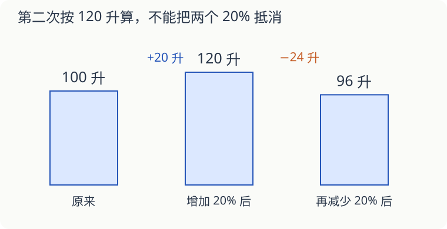

# 第 16 课：先增加，再减少，能回到原来吗

一桶水原来有 100 升。先增加原来水量的 20%，再倒出当时水量的 20%，最后还是 100 升吗？

## 两次的“20%”不是同样多

第一次以 100 升为整体，增加 20 升，变成 120 升。第二次以 120 升为整体，倒出 24 升，还剩 96 升。

连起来算是：100×（1＋20%）×（1−20%）＝96（升）。最后比原来少 4%，不能把一加一减的两个 20% 直接抵消。

## 知道最后的量，倒着算

如果只知道最后剩 96 升，前面仍按这两个比例变化，可以从最后往回走。倒出前有 96÷80%＝120 升；增加前有 120÷120%＝100 升。

除以 80% 的意思是：96 升只占倒出前的 80%，要找回那时的全部。

## 同一个整体和变化后的整体

“先用去原来的 1/4，再用去原来的 1/3”，两次都按原来的量算，剩下原来的 1−1/4−1/3＝5/12。

“先用去 1/4，再用去剩下的 1/3”，第二次换了整体，剩下原来的（1−1/4）×（1−1/3）＝1/2。题目里“原来”“剩下”都不能漏。

## 自己试一试

1. 200 增加 10% 后，再减少当时的 10%，结果是多少？
2. 一条绳用去 1/3，再用去剩下的 1/4，最后剩原来的几分之几？
3. 第 2 题最后剩 18 米，原来长多少米？
4. 80 减少 25% 后，要增加百分之几才能回到 80？
5. 120 页书，第一天读全书的 1/4，第二天读全书的 1/3，两天后剩多少页？
6. 第 5 题若第二天读的是“剩下的 1/3”，两天后剩多少页？

## 答案与说明

1. 200×1.1×0.9＝198，比原来少 2。
2. 2/3×3/4＝1/2。
3. 18÷1/2＝36 米。
4. 减少后是 60，要增加 20，20÷60＝1/3＝33⅓%。
5. 120×（1−1/4−1/3）＝50 页。
6. 120×3/4×2/3＝60 页。
