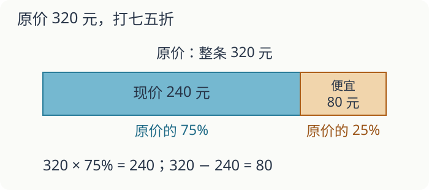

# 第 2 课：折扣、利率、税率

折扣、利息、税款都在算“整体的百分之几”，只是整体和百分率不同。

## 先找整体，再找百分率

下面的利率、税率都是题目给定的练习数据。利息按每年只对原本金计息、不把利息加入下一年本金的方式计算；税款按题设计税金额与单一税率计算，不引入其他费用。

这三类问题看起来不一样，关系式是同一个：

```
部分=整体×百分率
```

折扣：现价是原价的百分之几。八折就是 80%，八五折是 85%，七五折是 75%。

```
现价=原价×折扣率
原价=现价÷折扣率
```

“便宜多少”用原价减现价，也可以算原价×(1-折扣率)。

利息题先看清按什么本金、什么时间单位和计息方式来算。本课采用上述按原本金计息的条件：

```
利息=本金×年利率×年数
到期取回的钱=本金+利息
```

年利率 2% 表示本金 100 元存一年得利息 2 元。存 3 年，每年都按本金算利息，所以要乘 3。

税率：税款占计税金额的百分之几。

```
税款=计税金额×税率
```

税率 5% 表示每 100 元计税金额交 5 元税。

“成数”也是百分数：八成是 80%，三成五是 35%。“今年是去年的八成”就是今年=去年×80%；“比去年少二成”是今年=去年×(1-20%)，还是去年的 80%。两句话的数量关系一样。而“比去年少八成”，表示今年只剩去年的 20%。

## 例子

### 例 1：折扣

一件外套原价 320 元，打七五折。



```
320×75%=320×0.75=240（元）
```

现价 240 元，便宜 320-240=80 元。

### 例 2：利息

存 1000 元，年利率 2%，存 3 年。

```
1000×2%×3=1000×0.02×3=60（元）
```

到期取回 1000+60=1060 元。

### 例 3：税款

某商店一个月计税金额 80000 元，税率 5%。

```
80000×5%=80000×0.05=4000（元）
```

税款 4000 元。

## 易错

- 把八折当成便宜 8 元，或当成原价的 8%。八折是原价的 80%。
- 把七五折算成 7.5%。七五折是 75%。
- 算利息只算一年，忘记乘年数。
- 把年利率当成月利率。题目说年利率，时间就要按年算。
- 求原价时用乘法。现价 240 元是七五折，原价是 240÷0.75=320 元。
- 把“便宜百分之几”和“现价占百分之几”混在一起。打八折是现价占 80%，便宜 20%。

## 换个问法：知道今年，怎样求去年

“今年是去年的八成”中，去年是单位“1”。若今年收获 2400 千克，则去年×80%=2400，去年为 2400÷80%=3000 千克。不能直接把今年的收获增加 20% 当作去年的收获，因为这 20% 算的是今年的量。

**自己练一练**

1. 今年比去年少二成，今年 3600 千克，去年多少千克？
2. 今年比去年增加二成五，今年 5000 千克，去年多少千克？
3. “减少三成”与“减少到三成”分别剩下原来的百分之几？

**答案与解释**

1. 3600÷80%=4500 千克；
2. 二成五是 25%，5000÷125%=4000 千克；
3. 分别为 70%、30%。每题先写“现在是原来的几成”，再决定乘或除。

## 练习

1. 原价 480 元，打九折，现价多少元？便宜多少元？
2. 原价 600 元，打七五折，现价多少元？
3. 一件商品打八折后是 240 元，原价多少元？
4. 存 5000 元，年利率 2.25%，存 2 年，利息多少元？到期取回多少元？
5. 某商店某月计税金额 60000 元，税率 5%，税款多少元？
6. 一件衣服先打九折，再打八折，相当于原价的百分之几？

## 答案

1. 480×0.9=432（元）；便宜 480-432=48（元）。
2. 600×0.75=450（元）。
3. 240÷0.8=300（元）。
4. 5000×2.25%×2=5000×0.0225×2=225（元）；取回 5000+225=5225（元）。
5. 60000×5%=3000（元）。
6. 0.9×0.8=0.72，相当于原价的 72%，也就是七二折。
