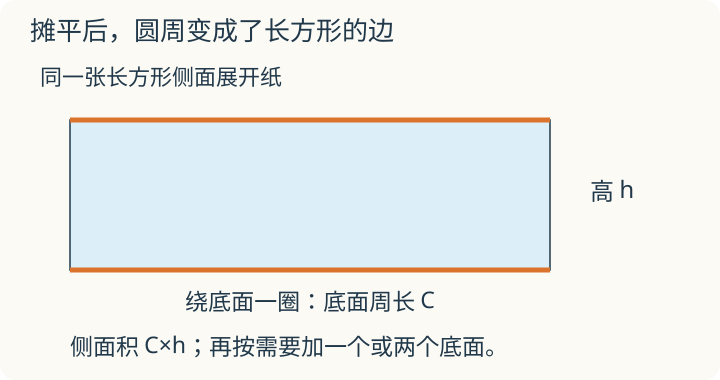

# 第 3 课：圆柱的表面积

给圆柱罐贴一圈标签，标签要多长才能刚好绕一圈？把侧面沿一条高剪开、摊平，看看这条长度原来贴着哪里。

## 把圆柱的侧面展开




圆柱的表面由三部分组成：上、下两个相同的圆，加一个弯曲的侧面。

想象把侧面沿一条高剪开，摊平，得到一个长方形：

- 长方形的长等于底面圆的周长，即 2πr 或 πd；
- 长方形的宽等于圆柱的高 h。

所以侧面积是底面周长乘高：

```
侧面积=2πrh
```

底面积是 πr²，有两个底面，因此

```
表面积=2πrh+2πr²
```

```
        侧面展开
   ┌──────────────────┐
   │                  │ 高 h
   └──────────────────┘
    长=底面周长 2πr
```

展开时，顶部那圈边变成了长方形的上边，底部那圈边变成了下边；剪开的同一条高变成左右两条边。它们只是换了位置，没有伸长。

本课材料题忽略厚度、接缝和裁剪损耗，π 按 3.14 计算。

## 例子

### 例 1：有盖圆柱

r=3 cm，h=10 cm，π 取 3.14。

```
侧面积：2×3.14×3×10=188.4（cm²）
底面积：3.14×3²=3.14×9=28.26（cm²）
表面积：188.4+28.26×2=188.4+56.52=244.92（cm²）
```

### 例 2：无盖水桶

r=2 dm，h=5 dm。

```
侧面积：2×3.14×2×5=62.8（dm²）
一个底面积：3.14×2²=12.56（dm²）
需要铁皮：62.8+12.56=75.36（dm²）
```

### 例 3：通风管

通风管两端开口，没有底面。r=0.5 m，长 2 m。

```
侧面积：2×3.14×0.5×2=6.28（m²）
```

只需要侧面积 6.28 m²。

## 易错

- 求侧面积时直接用半径乘高，漏掉 2π。侧面积是“底面周长×高”。
- 分不清有没有盖：有盖加 2 个底面积，无盖加 1 个，通风管不加。
- 直径和半径混用。题目给直径，先除以 2。
- 单位不统一。半径用厘米、高用米，要先化成同一单位。
- 把表面积和体积混在一起。表面积用平方单位，体积用立方单位。
- 计算底面积时忘了平方，把 πr² 算成 πr。

## 把长方形换个方向卷

一张长 12 厘米、宽 6 厘米的长方形纸，分别沿两个方向卷成不重叠、没有底面的圆柱侧面。侧面积会变吗？底面周长和高呢？

<details>
<summary>看解释</summary>

侧面积都为 12×6=72 平方厘米，纸没增减。第一种底面周长 12、高 6；第二种底面周长 6、高 12。侧面积相同，不等于两个圆柱的半径和体积都相同。

</details>

## 练习

1. 圆柱底面半径 2 cm，高 6 cm，求侧面积。（π 取 3.14）
2. 接上题，求这个圆柱的表面积。
3. 圆柱底面直径 4 dm，高 5 dm，求侧面积。
4. 一个无盖圆柱形水桶，底面半径 3 dm，高 4 dm，做这个水桶需要多少平方分米铁皮？
5. 一根圆柱形通风管，底面直径 0.6 m，长 1.5 m，需要多少平方米铁皮？
6. 圆柱的底面周长是 31.4 cm，高 8 cm，求侧面积。

## 答案

1. 2×3.14×2×6=75.36（cm²）。
2. 底面积 3.14×2²=12.56（cm²）；表面积 75.36+12.56×2=75.36+25.12=100.48（cm²）。
3. 3.14×4×5=62.8（dm²）。
4. 侧面积 2×3.14×3×4=75.36（dm²）；底面积 3.14×3²=28.26（dm²）；共 75.36+28.26=103.62（dm²）。
5. 3.14×0.6×1.5=2.826（m²）。
6. 31.4×8=251.2（cm²）。
