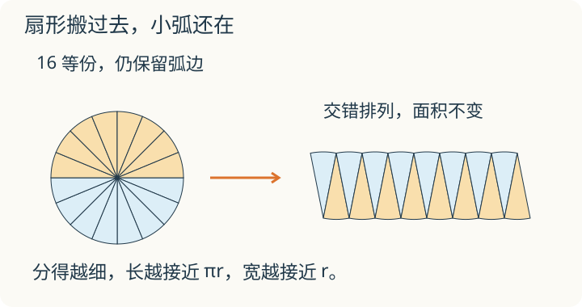
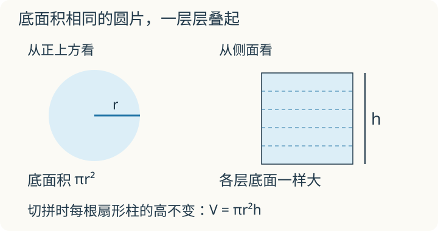

# 第 4 课：圆柱的体积

圆面积能靠切拼来理解，圆柱也能吗？把每一块小扇形连同它上面的整根“扇形柱”一起搬，看看能拼出什么。

## 把圆柱切拼成接近长方体的形状




先回想圆面积的切拼：把圆平均分成许多小扇形，交错排列，越分越接近长方形。

现在把同样的切线沿圆柱的高一直切下去，得到许多等高的扇形柱。把它们连同底面一起交错排列。每一块完整保留，没有重叠，没有切割损耗，所以体积没变。

分得越细，拼出的立体越接近长方体。底面的长越来越接近 πr，宽越来越接近 r；每块的高都保持 h，所以整个立体的高仍是 h。

长方体的体积是长×宽×高。沿着这个越来越接近的过程，可以理解圆柱的体积公式：

V=πr×r×h=πr²h=底面积×高。

有限块扇形柱拼好后仍有弯曲的小边，不能把它画成已经精确成为长方体。这是帮助理解公式的切拼过程。




再看一层层圆片：圆柱从下到上，每一个平行于底面的截面都一样大；因此可以用同一个底面积乘整个高。圆锥的截面会逐渐缩小，就不能直接照搬这个乘法。

如果题目给直径，先求半径 r=d÷2；给底面周长，则 r=C÷(2π)。下面数值题按 π 取 3.14 计算。

## 例子

### 例 1：给半径

r=2 cm，h=5 cm。

```
V=3.14×2²×5=3.14×4×5=62.8（cm³）
```

### 例 2：给直径

d=10 cm，h=4 cm。

```
r=10÷2=5（cm）
V=3.14×5²×4=3.14×25×4=314（cm³）
```

### 例 3：水杯装水

圆柱形水杯内直径 8 cm，水深 10 cm。

```
r=4 cm
V=3.14×4²×10=3.14×16×10=502.4（cm³）
```

502.4 cm³=502.4 mL。

## 易错

- 把直径当半径代入。d=10 cm 时用 10 算，结果会变成正确结果的 4 倍。
- 忘记乘高，只算了底面积。
- 底面积算成 2πr（周长），而不是 πr²。
- 容积要从容器里面量。题目给外直径时，不能直接当内直径。
- 单位换算出错：1 L=1000 mL=1000 cm³，1 dm³=1000 cm³。
- 把体积单位和面积单位混用。体积用立方单位。

## 高增加 1 厘米，多出多少体积

一个圆柱底面积 12 平方厘米，高从 5 厘米增加到 6 厘米。多出的体积是多少？需要从头算两遍吗？

<details>
<summary>看解释</summary>

多出一层高 1 厘米、底面积 12 平方厘米的圆柱，体积增加 12×1=12 立方厘米。也可检查 12×6−12×5=12。

</details>

## 练习

1. 圆柱底面半径 3 cm，高 7 cm，体积是多少？
2. 圆柱底面直径 6 dm，高 10 dm，体积是多少？
3. 圆柱底面周长 12.56 m，高 3 m，体积是多少？
4. 圆柱形水桶内底面积 50 cm²，水深 12 cm，水的体积是多少毫升？
5. 一个圆柱的体积是 314 cm³，底面积是 78.5 cm²，高是多少厘米？
6. 把 1 升水倒入底面积 100 cm²、足够高的圆柱形容器，水面高多少厘米？

## 答案

1. 3.14×3²×7=3.14×9×7=197.82（cm³）。
2. r=3 dm；3.14×3²×10=3.14×9×10=282.6（dm³）。
3. r=12.56÷(2×3.14)=2（m）；3.14×2²×3=3.14×4×3=37.68（m³）。
4. 50×12=600（cm³）=600（mL）。
5. 314÷78.5=4（cm）。
6. 1 L=1000 cm³；1000÷100=10（cm）。
