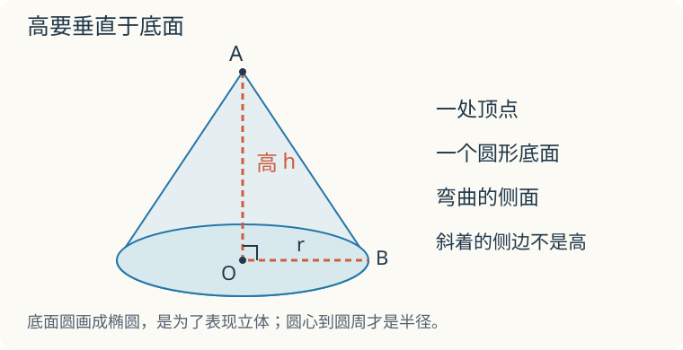

# 第 5 课：圆锥的体积

底面和高都一样，圆锥能装的水比圆柱少多少？先把两个容器的内部底面和高度对齐，再看灌装演示。

## 先找圆锥的高



本课研究直圆锥。它有一个圆形底面、一个顶点，侧面是弯曲的。顶点在底面圆心的正上方，顶点到底面圆心的线段垂直于底面，这条线段的长度就是高。沿外侧斜着量出的长度不是高，不能代入体积公式。

指图检查：底面半径、高分别是哪一条线？答案是底面圆心 O 到圆周的线段，以及顶点 A 到 O 的垂直线段。

## 圆锥和圆柱的体积怎样比较

圆锥和圆柱的底面一样大、高也一样时，圆锥只占圆柱的一部分。这个比是 1:3，不是 1:2。

可以观察这样的灌装演示：用内部等底等高的圆锥、圆柱容器，把圆锥装满水再倒进圆柱，连续倒三次，圆柱恰好装满。实际演示有读数和操作误差，但能帮助理解“三份圆锥装一份圆柱”。

计算时可以用这个结论：圆锥体积等于与它等底等高的圆柱体积的 1/3。灌水演示能帮我们看懂这个关系，但一次演示还不能证明所有圆锥都这样；光看“上面越来越细”，也得不出 1/3。读懂演示的意思就可以，不用在家做实验。

```
   圆锥              圆柱
     △               ┌────┐
    △△               │    │
   △△△               │    │
  △△△△               └────┘
 逐渐缩小            每层一样
```

关系式：

```
V圆锥=1/3×S底×h
V圆柱=S底×h=3×V圆锥
```

等底等高能保证体积比为 1:3。若没有这个条件，不能直接套这个比例，要分别计算。有些底面和高都不同的圆锥、圆柱，体积也可能恰好是 1:3。

下面计算中，π 取 3.14。

## 例子

### 例 1：给底面积

S=30 cm²，h=9 cm。

```
V=1/3×30×9=10×9=90（cm³）
```

### 例 2：给半径

r=3 m，h=4 m。

```
S底=3.14×3²=28.26（m²）
V=1/3×28.26×4=28.26×4÷3=113.04÷3=37.68（m³）
```

### 例 3：沙堆

沙堆底面直径 4 m，高 1.5 m。

```
r=2 m
S底=3.14×2²=12.56（m²）
V=1/3×12.56×1.5=12.56×0.5=6.28（m³）
```

## 易错

- 忘记乘 1/3，把圆锥体积算成圆柱体积。
- 把 1/3 重复乘。V=1/3Sh 中三个数相乘，1/3 只出现一次。
- 没有比较底面和高，就认定圆锥是题中圆柱的 1/3。等底等高时可直接判断；其他情况需要计算。
- 把直径当半径。d=4 m，r=2 m。
- 把“某个圆柱”读成“任意圆柱”。每个圆锥都能找到等底等高的圆柱，但换一个圆柱不一定仍有这个体积比。
- 体积单位写成平方单位。

## 只有高一样，还能说三分之一吗

一个圆锥与一个圆柱同高，但圆锥的底面积是圆柱的 2 倍。圆锥体积还是圆柱的 1/3 吗？

<details>
<summary>看解释</summary>

不是。设圆柱底面积为 S、高为 h，它的体积是 Sh；圆锥底面积为 2S，体积为 (1/3)×2S×h，是圆柱的 2/3。等底等高时才能直接用 1:3。

</details>

## 练习

1. 圆锥底面积 24 dm²，高 6 dm，体积是多少？
2. 圆锥底面半径 2 cm，高 9 cm，体积是多少？
3. 圆锥底面直径 6 m，高 5 m，体积是多少？
4. 一个圆锥的体积是 60 cm³，底面积是 20 cm²，高是多少厘米？
5. 一个圆柱与一个圆锥等底等高，圆柱体积是 90 cm³，圆锥体积是多少？
6. 判断：任何一个圆锥的体积都是某个圆柱的 1/3。

## 答案

1. 1/3×24×6=48（dm³）。
2. 3.14×2²=12.56（cm²）；1/3×12.56×9=37.68（cm³）。
3. r=3 m；3.14×3²=28.26（m²）；1/3×28.26×5=47.1（m³）。
4. 60×3÷20=9（cm）。
5. 90÷3=30（cm³）。
6. 对。对任何一个圆锥，都能取一个与它等底等高的圆柱，这就是题目说的“某个圆柱”。若改成“任意圆柱”，则不成立。
