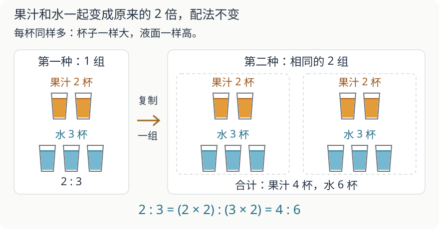

# 第 6 课：比例

2 杯果汁配 3 杯水，4 杯果汁配 6 杯水，每杯同样多。这两种配法的果汁与水之比相同，可以写成 2:3=4:6。表示两个比相等的式子叫比例。

## 两个比为什么相等

把第二种配法分成两组，每组都是 2 杯果汁、3 杯水。果汁和水同时变成原来的 2 倍，配法没有变。

判断两个比能否组成比例，可以先化简，也可以求比值：

- 6:9=2:3，10:15=2:3，所以 6:9=10:15。
- 2:3 和 4:5 不相等。果汁变成了 2 倍，水却没有跟着变成 2 倍，配法变了。

比表示两个量相除；比例说的是两个比相等。比的后项不能为 0。

## 空格里该填多少

### 例 1：□:8=3:4

从右边的比看，4 变成 8，是原来的 2 倍；前项也要变成 2 倍：3×2=6。因此填 6。

检验：6:8=3:4。

### 例 2：3:□=6:10

6 变成 3，是原来的一半；10 也要取一半，得到 5。因此填 5。

检验：3:5=0.6，6:10=0.6。

### 例 3：放大照片

一张照片长与宽的比是 4:3。放大后长 20 厘米，宽是多少？

长占 4 份，共 20 厘米，所以每份是 20÷4=5 厘米。宽占 3 份，是 5×3=15 厘米。

检验：20:15=4:3。长和宽按同样的倍数变化，照片的形状才没有变。

## 易错

- 只改比的前项，不改后项。两个量要按相同倍数变化，比值才不变。
- 颠倒比较顺序。长:宽=4:3，不能把宽放在前面仍写 4:3。
- 单位混用。比较两组路程与时间时，要让路程单位一致，时间单位也一致。
- 填完不检查。把两个比化简或求比值，看看是否相等。

## 基础练习

1. 6:9 和 10:15 能否组成比例？说说你的判断方法。
2. 填空：□:5=8:10。
3. 填空：3:4=12:□。
4. 填空：2.5:□=5:8。
5. 照片长与宽的比是 4:3，放大后长 20 厘米，宽是多少？
6. 用 2、3、4、6 组成一个比例，每个数用一次。

## 答案

1. 能。两个比化简后都是 2:3。
2. 4。10 变成 5，8 也取一半。
3. 16。3 变成 12，是原来的 4 倍；4×4=16。
4. 4。5 变成 2.5，是原来的一半；8÷2=4。
5. 20÷4×3=15（厘米）。
6. 例如 2:3=4:6，也可以写 3:2=6:4、2:4=3:6。

初中衔接选学：用等式性质解比例

先学过方程，再读这一段。比例 a:b=c:d 写成分数是 a/b=c/d，b、d 都不能为 0。等式两边同乘 bd，得到 ad=bc。a、d 叫外项，b、c 叫内项，因而外项积等于内项积。

例如解比例 3:x=6:10，可以写成 6x=3×10=30，得到 x=5。检验时仍要看两个比是否相等，并检查后项不为 0。

试一试 x:8=3:4。按这个方法，4x=8×3=24，x=6，和前面用相同倍数得到的结果一样。

