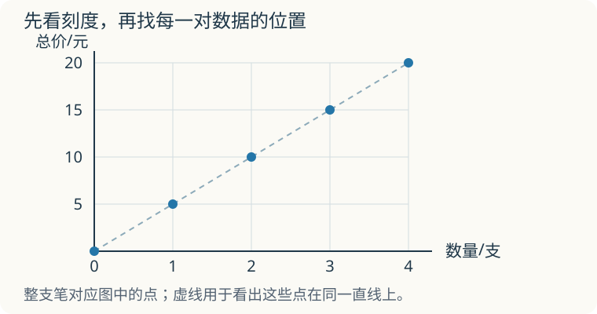

# 第 7 课：正比例

每支笔 5 元，买 1 支、2 支、3 支……总价每次增加多少？再看总价除以支数，为什么始终是同一个数？

## 单价不变，多买几支要多付多少钱

看总价和数量。单价 5 元/支：

数量 1 支，总价 5 元；2 支，10 元；3 支，15 元；4 支，20 元。

```
总价÷数量=5（一定）
```

数量扩大到原来的 2 倍，总价也扩大到原来的 2 倍；数量扩大到 3 倍，总价也扩大到 3 倍。这样的两个量成正比例，记作

```
y÷x=k（x≠0，k 一定，k≠0），也就是 y=kx
```

图像为什么是直线？把每对数据画成点：(1,5)、(2,10)、(3,15)、(4,20)。x 每增加 1，y 都增加 5，增加量相同，点在同一条直线上。x=0 时 y=0，所以这些点所在的直线过原点。买整支笔时，只取整数支数对应的点；像匀速走路的时间可以连续取值，才可以用连续线段表示允许的那些数据。

判断正比例，只看一条：两个量的比值是不是一定。比值一定，成正比例；比值变了，就不成。

正方形周长与边长：C÷a=4，一定，成正比例。

正方形面积与边长：S÷a=a，随着 a 变，比值也变，不成正比例。

## 例子

### 例 1：单价一定

单价 5 元/支。

| 数量/支 | 1 | 2 | 3 | 4 |
|---|---|---|---|---|
| 总价/元 | 5 | 10 | 15 | 20 |

总价÷数量=5，总价与数量成正比例。

### 例 2：速度一定

速度 60 km/h。

| 时间/h | 1 | 2 | 3 |
|---|---|---|---|
| 路程/km | 60 | 120 | 180 |

路程÷时间=60，路程与时间成正比例。

### 例 3：正方形

边长 1、2、3、4 cm，周长 4、8、12、16 cm。周长÷边长=4，周长与边长成正比例。

面积 1、4、9、16 cm²。面积÷边长=1、2、3、4，比值不固定，面积与边长不成正比例。

## 把数据画成点



先看横轴表示支数、纵轴表示总价，再看刻度：横着一格是 1 支，竖着一格是 5 元。买 3 支共 15 元，就在“横着 3、竖着 15”的地方标一个点。

图中虚线帮助看出这些点排在同一直线上。整支笔不能买 1.5 支，所以这里实际可选的是整数支数对应的点，不能把虚线上的每个位置都当成一种购买方案。

**自己画一张**：每本本子 3 元，买 0、1、2、3、4 本，总价分别是多少？在方格纸上标出这 5 个点，写清两条轴表示什么，每格是多少。

**核对**：总价分别是 0、3、6、9、12 元，对应 (0,0)、(1,3)、(2,6)、(3,9)、(4,12)。横轴可每格 1 本，纵轴可每格 3 元。5 个点应在同一条直线上，且经过原点。刻度也可另选，但间隔要一致、标注要清楚。

## 易错

- 只看“一个量变大，另一个也变大”就判断正比例。还要看比值是否一定。
- 把“和一定”当成正比例。例如长+宽=10，长与宽不成正比例。
- 认为图像不过原点也成正比例。正比例图像一定过原点。
- 把正方形面积与边长当成正比例。面积÷边长=边长，比值在变。
- 比较不同数据时随意交换相除顺序。每组都要按同一顺序算。对正的对应量，y÷x 固定时 x÷y 也固定，都能判断正比例；但若要求 y=kx 中的 k，就必须求 y÷x，并写清单位。不能用含 0 的一组作除法判断。
- 认为人的年龄和身高成正比例。身高增长的速度并不固定。

## 每次都增加 5 元，就够了吗

另一个店每单另收 2 元包装费，笔仍是每支 5 元。买 1、2、3 支的总价分别是 7、12、17 元，每多一支也增加 5 元。总价与支数成正比例吗？

<details>
<summary>看解释</summary>

不成正比例。7÷1=7，12÷2=6，比值不固定；买的数量翻倍，总价也没有翻倍。固定的包装费使每一份承担的费用不同。

</details>

## 练习

1. 单价一定，总价和数量成什么比例？为什么？
2. 下表 x 与 y 是否成正比例？比值是多少？

| x | 1 | 2 | 3 | 4 |
|---|---|---|---|---|
| y | 3 | 6 | 9 | 12 |

3. 正方形边长 1、2、3、4 cm，面积 1、4、9、16 cm²。面积与边长成正比例吗？
4. 圆的周长与直径成正比例吗？比值是多少？
5. 一辆汽车 3 小时行驶 180 km。照这个速度，5 小时行驶多少千米？路程与时间成什么比例？
6. 判断：y=2x+1 中，y 与 x 成正比例吗？

## 答案

1. 成正比例。总价÷数量=单价（一定）。
2. 成正比例。3÷1=6÷2=9÷3=12÷4=3。
3. 不成正比例。面积÷边长=边长，比值不固定。
4. 成正比例。周长÷直径=π（一定）。
5. 180÷3=60（km/h）；60×5=300（km）。路程与时间成正比例。
6. 不成正比例。x=1 时 y=3，比值是 3；x=2 时 y=5，比值是 2.5。比值不固定，且 x=0 时 y=1，图像不过原点。
