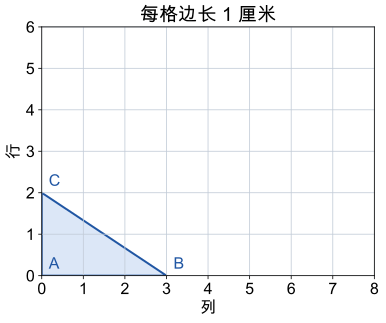

# 第 9 课：比例尺

把照片的长和宽都放大到原来的 2 倍，能装下几张原照片？图上长度比和面积比为什么不是同一个数？

## 图上一厘米，实际有多远


地图不能按实际大小画，只能缩小。比例尺 1:100 表示图上 1 cm 对应实际 100 cm。

```
图上距离:实际距离=1:100
```

比例尺是一个比，没有单位。1:100 也可以写成 1/100。

由这个比可以得到：

```
实际距离=图上距离÷比例尺
图上距离=实际距离×比例尺
```

比例尺写成 1:n 时，也可以直接算：

```
实际距离=图上距离×n
图上距离=实际距离÷n
```

例如图上 3 cm，比例尺 1:100，实际距离是 3×100=300 cm=3 m。

单位要统一。1 m=100 cm，1 km=1000 m=100000 cm。

比例尺 1:100000 表示图上 1 cm 对应实际 100000 cm，也就是 1 km。

面积不能直接按比例尺算。比例尺 1:100 时，图上 1 cm 代表实际 100 cm；图上 1 cm² 代表实际 100 cm×100 cm=10000 cm²。所以面积比是 1:10000，是比例尺的平方。

放大比例尺如 2:1，表示图上 2 份对应实际 1 份，图上距离比实际距离大。

## 例子

### 例 1：求实际距离

地图比例尺 1:5000000，图上两地相距 4.2 cm。

```
实际距离=4.2×5000000=21000000（cm）
21000000 cm=210 km
```

### 例 2：求图上距离

教室长 9 m，画在比例尺 1:300 的图纸上。

```
9 m=900 cm
图上距离=900÷300=3（cm）
```

### 例 3：面积比

比例尺 1:200，图上长方形长 3 cm、宽 2 cm。

```
实际长：3×200=600 cm=6 m
实际宽：2×200=400 cm=4 m
实际面积：6×4=24（m²）=240000 cm²
图上面积：3×2=6（cm²）
6:240000=1:40000
```

1:40000 正好是 1:200 的平方。

## 易错

- 图上距离和实际距离单位不统一就直接乘除。先把它们化成同一单位。
- 把比例尺当成有单位的量。比例尺是一个比，后面不写 cm 或 m。
- 求实际距离时不看比例尺就乘后项。统一单位后，实际距离=图上距离÷比例尺；1:n 时等于乘 n，2:1 时则应除以 2。
- 把面积比当成比例尺。1:100 的图上面积比是 1:10000。
- 把放大比例尺看成缩小。2:1 是放大 2 倍。
- 比例尺前后项颠倒。1:100 不能写成 100:1。

## 独立作图：按相同比放大和缩小

先会数对、方格作图和三角形面积。下面每格边长 1 厘米，A=(0,0)、B=(3,0)、C=(0,2)。先看示范：把两条直角边都放大到原来的 2 倍，保持 A 不动，B 到 (6,0)、C 到 (0,4)，连接三点，得到形状相同、大小改变的三角形。只把一条边加倍会改变形状。



**自己试一试**

1. 在方格上画出放大后的三角形，再把它按 1:2 缩小，是否回到原图？
2. 画一个长 4 格、宽 2 格的长方形，再按 1:2 缩小，检查每条对应边。
3. 长度变为 2 倍时，三角形面积是否也只变 2 倍？正方体三条方向的边长都变 2 倍，体积又怎样？

**核对答案**

1. 放大后三点为 (0,0)、(6,0)、(0,4)，缩小后回到 (0,0)、(3,0)、(0,2)。
2. 新长 2 格、宽 1 格，位置不限，各对应边都为原来的一半。
3. 原面积 3×2÷2=3 平方厘米，新面积 6×4÷2=12 平方厘米，是 4 倍；正方体体积变为 2×2×2=8 倍。画完要检查各条对应边是不是按同样的倍数变了，形状有没有变，不能只写出倍数。

## 面积变成 4 倍，就一定按 2:1 放大了吗

把一个长方形只沿长的方向拉到 4 倍，宽不变，面积也是 4 倍。能说它按 2:1 放大了吗？

<details>
<summary>看解释</summary>

不能。按 2:1 放大要求每条对应长度都变成 2 倍。这里只拉长一个方向，长宽比变了，形状也变了；只知道面积的倍数，不能确定怎样缩放。

</details>

## 练习

1. 比例尺 1:1000，图上 5 cm 表示实际多少米？
2. 实际距离 6 km，比例尺 1:200000，图上距离是多少厘米？
3. 地图上 3 cm 表示实际 15 km，求这张地图的比例尺。
4. 比例尺 1:100，图上长方形长 4 cm、宽 2 cm，实际面积是多少平方米？
5. 在比例尺 1:500 的图纸上，一个正方形的边长是 2 cm，实际面积是多少平方米？
6. 判断：比例尺 1:100，图上面积是实际面积的 1/100。

## 答案

1. 5×1000=5000（cm）=50（m）。
2. 6 km=600000 cm；600000÷200000=3（cm）。
3. 15 km=1500000 cm；3:1500000=1:500000。
4. 实际长 4×100=400 cm=4 m，宽 2×100=200 cm=2 m；面积 4×2=8（m²）。
5. 实际边长 2×500=1000 cm=10 m；面积 10×10=100（m²）。
6. 错。图上面积是实际面积的 1/10000。
