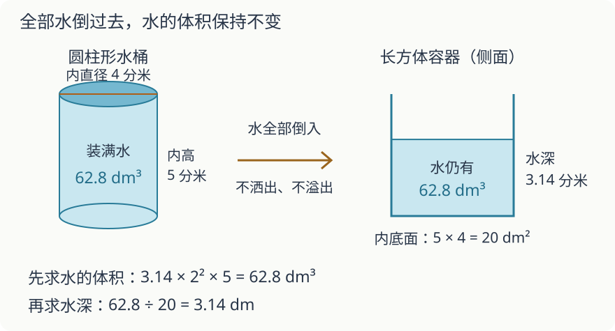

# 第 12 课：整理与复习

一道题可能要用上好几课的知识。先看清已知什么、要求什么，再想每一步要算什么，算完还要放回题里检查。

## 把学过的知识放在一起看看

下面先回顾小学基础内容。方程求解、反比例和鸽巢提高题，可在学有余力时另选，不作为完成基础复习的条件。

- 数表示什么：整数、小数的每个数位表示多大的单位；分数、百分数把谁看作整体；正负数从哪里分界。
- 什么变了，什么没变：约分和通分时分数大小不变；等式两边加上或减去同一个数，或乘同一个数、除以同一个非零数，仍然相等。图形剪拼时，只要不重叠、不遗漏，面积就不变；水全部倒入别的容器且没有洒出、溢出时，水量不变。
- 怎样计算：什么时候用加减乘除，按什么顺序算，哪些运算律能让计算简便。
- 数量之间有什么关系：比、比例、正比例，以及总价、路程怎样算。
- 怎样测量：长度和面积有什么不同，表面积和体积各算什么，单位怎样换算。
- 图形怎样移动或变化：平移、旋转、轴对称，以及放大和缩小。
- 怎样找规律：从数列和图形里找相同的变化，再想后面会怎样。
- 怎样看数据：读条形图、折线图和扇形图，比较可能性，说清楚数据能告诉我们什么。

复习时，读到一道题，可以先找一找哪些数量有关系。下面这些关系还记得吗？

- 总量=部分+部分；
- 总价=单价×数量；
- 路程=速度×时间；
- 长方形面积=长×宽，圆柱体积=底面积×高；
- 部分=整体×百分率；
- 两个正的对应量的比值一定，成正比例。

有些综合题要接连用到两个数量关系。可以这样做：

1. 把题目里的量写出来，标上单位；
2. 看哪些量没有变，比如水的体积、总面积或总钱数；
3. 找到数量之间的关系，列出算式；
4. 算完检查单位和合理性。

比如圆柱形水桶的水倒进长方体容器，水的体积不变：先用圆柱体积公式算出水的体积，再用“体积÷底面积=高”求水深。

下面计算中，π 取 3.14。

## 例子

### 例 1：圆柱与长方体

圆柱形水桶内部底面直径 4 dm，内高 5 dm，装满水。把水全部倒入内部长 5 dm、宽 4 dm、足够高的长方体容器，水深多少？



```
r=2 dm
V水=3.14×2²×5=3.14×4×5=62.8（dm³）
长方体底面积=5×4=20（dm²）
水深=62.8÷20=3.14（dm）
```

水的体积没有变，变的是容器的底面积。

### 例 2：按比分配

120 本书按 2:3 分给甲、乙两班。

```
总份数=2+3=5
一份=120÷5=24（本）
甲=24×2=48（本）
乙=24×3=72（本）
```

检验：48+72=120，48:72=2:3。

### 提高选学：鸽巢

37 人，至少有几人在同一个月过生日？

```
37÷12=3……1
```

至少 4 人。

## 易错

- 拿到综合题就套公式，不先统一单位。例如长方形的两条边都以分米给出，却把相乘后的数直接写成平方厘米，得到的数只有正确平方厘米数的 1/100；只错一条边时又不同，必须逐个检查单位。
- 忘了看哪些量没有变。水倒来倒去，体积不变；图形不重叠、不遗漏地拼，面积不变。
- 弄错了和谁比较。“比去年多 20%”，要按去年的量来算，今年=去年×120%。
- 表面积和体积混用。表面积用平方单位，体积用立方单位。
- 算出答案不检验。代回去看是否满足题目的关系，单位是否合理。
- 做完就放下，没有想一想题和题的联系。有些题换了数字，数量之间的关系还是一样的。

## 自己试一试：先想每一步，再计算

先独立做，暂不看答案。可以画图、列表或列算式；每题都要解释用了哪些关系。

### 任务一：校园花圃采购

一块长 12 米、宽 8 米的长方形场地，60% 的面积种花。每包种子能种 12 平方米，只能整包购买。同一种种子，甲店每包 18 元，一次买满 5 包整单打九折；乙店每 3 包 48 元，不足 3 包的部分每包 18 元。可以买多，但本题不考虑退货或运费。

1. 至少需要几包？为什么不能四舍五入取包数？
2. 比较两店，怎样购买更省？说明多买是否可能更便宜。
3. 预算只有 80 元，能否按原计划完成？给出计算依据。

### 任务二：比例尺、步行与时间安排

地图比例尺为 1:20000，家到图书馆沿步行路线量得 3 厘米。小明每分钟走 60 米，全程保持这个速度。预约活动 9:00 开始、持续 45 分钟，要求至少提前 5 分钟到达；结束后沿原路步行回家，中途不停留。

1. 最晚几点从家出发？
2. 活动结束立即回家，几点到家？从最晚出发到回家共多久？
3. 小明说“地图只有 3 厘米，所以走 3 分钟就够”。他混淆了哪些量？

### 答案与检查方法

**任务一**

场地面积是 12×8=96 平方米，其中种花的面积是 96×60%=57.6 平方米。57.6÷12=4.8，4 包只能种 48 平方米，不够，所以至少要买 5 包。

买 5 包，甲店要 5×18×90%=81 元；乙店要 48+2×18=84 元。多买会不会更便宜？甲店买 6 包已经要 97.2 元，继续多买，费用还会增加。乙店买 6 包要 96 元，以后每多买一包或一组，费用也继续增加，所以多买并不省钱。

选甲店买 5 包，花 81 元。预算 80 元还差 1 元，按题里的安排无法完成。

**任务二**

实际路线长 3×20000=60000 厘米=600 米，走一趟需要 600÷60=10 分钟。

要在 8:55 前或恰好 8:55 到达，最晚 8:45 就要出发。活动 9:45 结束，回到家是 9:55。

从出门到回家共 70 分钟，包括去程 10 分钟、提前等待 5 分钟、活动 45 分钟和回程 10 分钟。地图上的长度要先按比例尺换成实际路程，再除以速度，不能直接把厘米当分钟。

做完每题，检查四件事：

1. 题里的总量和单位找对了吗？
2. 用到了哪两个数量关系，为什么要先算这一步？
3. 种子要整包买、店铺优惠怎么算，或活动要提前到达，这些条件都顾到了吗？
4. 把答案放回原题，每个条件都满足吗？

每一项都试着自己讲一遍。能独立讲清楚记 1 项，共 4 项；需要提示的另外记下来，下次再试。用了不同的算法，只要符合题意、计算正确，也可以。

## 基础回顾练习

1. 计算：3/4+1/6。
2. 两袋同样重的米，加上 5 千克后共重 17 千克。每袋米原来重多少千克？
3. 圆柱底面半径 2 cm，高 6 cm，体积是多少？
4. 一件商品原价 500 元，打八折，现价多少元？
5. 地图比例尺 1:300000，图上 4 cm，实际距离是多少千米？
6. 袋里只有 3 个红球和 1 个蓝球，除颜色外都相同。摇匀后不看袋内，任意摸一个，一定是红球吗？哪种颜色更可能摸到？

## 答案

1. 3/4=9/12，1/6=2/12；9/12+2/12=11/12。
2. 两袋共重 17−5=12 千克；每袋重 12÷2=6 千克。
3. 3.14×2²×6=3.14×4×6=75.36（cm³）。
4. 500×80%=500×0.8=400（元）。
5. 4×300000=1200000（cm）=12（km）。
6. 不一定，也可能摸到蓝球；红球更多，摸到红球的可能性较大。
