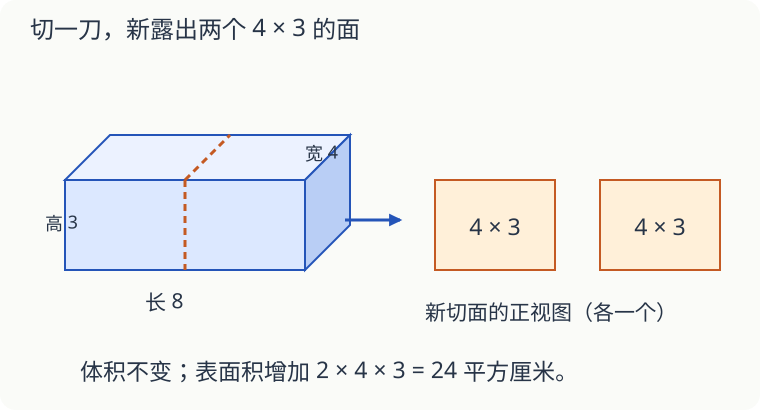

# 第 13 课：切开以后，什么变多了

一个长方体木块，长 8 厘米、宽 4 厘米、高 3 厘米。沿着长的中点竖直切一刀，得到两个长、宽、高分别为 4、4、3 厘米的小木块。忽略锯缝损耗。

## 体积不变，多出两个切面

切开前体积是 8×4×3＝96 立方厘米。切开后两块合计 4×4×3×2＝96 立方厘米。

原表面积是（8×4＋8×3＋4×3）×2＝136 平方厘米。一刀产生两个新面，每个面积 4×3＝12 平方厘米，因此两块表面积之和是 136＋12×2＝160 平方厘米。

“切一刀”不等于只增加一个面。刀口两边各有一个。

## 拼起来，被遮住的是两个面

把两块重新沿切面贴紧，两个 12 平方厘米的面都藏在里面，外表面积减少 24 平方厘米，回到 136 平方厘米。

如果改变拼法，表面积也可能不同。两块棱长 2 厘米的正方体，沿完整的面拼成长方体，原来合计 48 平方厘米，藏起两个各 4 平方厘米的面，剩 40 平方厘米。

## 圆柱也可以这样想

把圆柱平行于底面切成两段，增加的是两个圆形底面。若半径是 2 厘米，表面积增加 2×π×2²＝8π 平方厘米，与切口离底面多远无关。沿别的方向切，切面形状就可能不同。

## 自己试一试

1. 配图长方体切开前后，体积分别是多少？
2. 配图切法使表面积增加多少？
3. 同一木块若沿着高的中点水平切一刀，表面积增加多少？
4. 三个棱长 2 厘米的正方体排成一行，相邻面完全贴合，外表面积是多少？
5. 半径 3 厘米的圆柱，平行于底面切一刀，表面积增加多少？π 取 3.14。
6. 切开木块后，能用增加的表面积去加原来的体积吗？

## 答案与说明

1. 都是 96 立方厘米，假定没有切割损耗。
2. 4×3×2＝24 平方厘米。
3. 新面是 8×4 的长方形，增加 8×4×2＝64 平方厘米。
4. 3×6×2²−2×2×2²＝56 平方厘米。两处连接，每处藏起两个面；也可按 6×2×2 的长方体算。
5. 2×3.14×3²＝56.52 平方厘米。
6. 不能。表面积用平方单位，体积用立方单位，表示的量不同。
