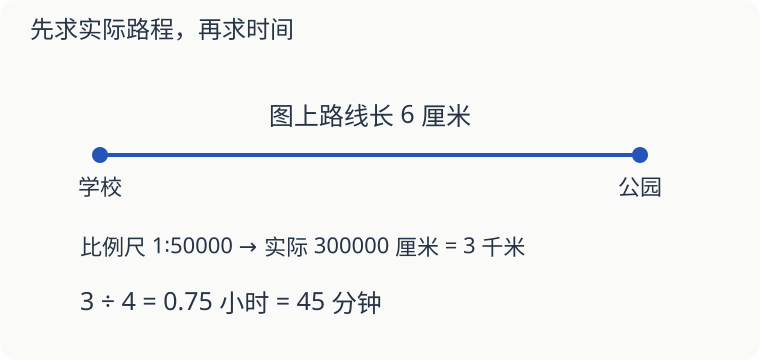

# 第 14 课：图上六厘米，路上要走多久

一张地图的比例尺是 1∶50000，两地之间标出的路线在图上长 6 厘米。先把图上距离变成实际距离，再算时间。

## 单位别在中途换丢了

实际路程是 6×50000＝300000 厘米＝3000 米＝3 千米。

以每小时 4 千米的平均速度走这条路线，需要 3÷4＝0.75 小时，也就是 45 分钟。不能把 0.75 小时写成 75 分钟。

这里量的是地图上标出的路线长度。如果量的只是两地之间的直线，实际道路弯曲，就不能直接当作走路的路程。

## 速度比，什么时候能变成路程比

甲、乙速度比为 3∶2。如果行走时间一样，路程比也是 3∶2；如果走同样长的路，时间比就是 2∶3，走得快的用时少。把同一路程看成 6 份：每小时走 3 份的用 2 小时，每小时走 2 份的用 3 小时，因此用时比为 2:3。

要是甲走了 2 小时、乙走了 3 小时，就不能直接说路程比是 3∶2。把它们分别看成每小时走 3 份、2 份，这次路程比为（3×2）∶（2×3）＝1∶1。

## 休息时间不算在行走时间里

一段 12 千米的路，行走平均速度为每小时 4 千米，走路用 3 小时。中途另休息半小时，从出发到到达共 3.5 小时。这半小时没有前进，不能再乘速度当作路程。

## 自己试一试

1. 比例尺 1∶20000，路线图上长 4 厘米，实际长多少米？
2. 走第 1 题的路线，平均每分钟 80 米，需要几分钟？
3. 实际 5 千米的路线，画在 1∶100000 的地图上长多少厘米？
4. 两人速度比为 5∶4，同样走 20 千米，用时比是多少？
5. 两人速度比为 5∶4，甲走 2 小时、乙走 3 小时，路程比是多少？
6. 小明 8:00 出发，以行走平均速度每小时 4 千米走完 12 千米，中途另休息 30 分钟。几点到达？

## 答案与说明

1. 4×20000＝80000 厘米＝800 米。
2. 800÷80＝10 分钟。
3. 500000÷100000＝5 厘米。
4. 4∶5，同路程下时间比与速度比相反。
5. （5×2）∶（4×3）＝10∶12＝5∶6。
6. 12÷4＝3 小时，再加半小时，11:30 到达。
