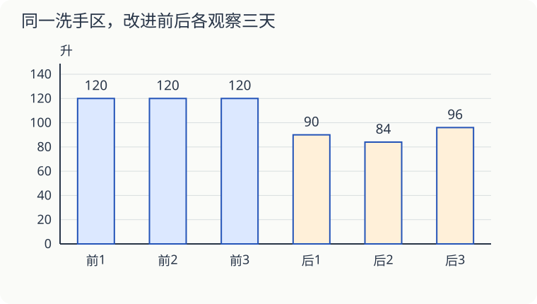

# 第 15 课：一张表，能说明节水了吗

学校记录了同一处洗手区的用水量。改进前，三个观察日都是 120 升；改进后，三个观察日分别为 90、84、96 升。

## 先比较每天平均用水量

改进后平均每天用水（90＋84＋96）÷3＝90 升，比改进前平均少 120−90＝30 升，减少了 30÷120＝25%。

百分之几要除以改进前的量。30÷90 表示相对改进后的量多多少，不是这里要问的减少率。

## 还要问：来洗手的人一样多吗

如果改进前一天有 200 人次洗手，用水 120 升，平均每人次 0.6 升；改进后有 150 人次，用水 90 升，仍是每人次 0.6 升。这一天用水总量少了，可能只是人次少了。

所以要记录观察时长、使用人次等条件，再看平均每人次用水量是否下降。人次也不等于人数：同一个人来了三次，要计三人次。

## 用观察结果估算，要说清条件

如果以后每天仍能节约 30 升，20 个上课日可以估计节约 30×20＝600 升。但三个观察日还不足以保证每一天都一样，可以继续记录一周或更长时间。

调查时可以记录公开的汇总数，不需要记下同学姓名。

## 自己试一试

1. 改进后三天共用水多少升？平均每天多少升？
2. 与改进前相比，平均每天少用水多少升？减少率是多少？
3. 每天节约 30 升，15 个上课日预计节约多少升？这个估计用了什么假设？
4. 改进前 200 人次用 120 升，改进后 200 人次用 90 升。平均每人次分别用多少升？
5. 改进后只有 150 人次用 90 升，能仅凭总量认定每人次更节水吗？
6. 调查只选用水最少的一天作为改进后的成绩，合适吗？

## 答案与说明

1. 270 升；90 升。
2. 30 升；30÷120＝25%。
3. 450 升。假设之后每个上课日都能节约 30 升。
4. 分别为 0.6 升、0.45 升；每人次减少 0.15 升。
5. 不能。90÷150＝0.6 升，与改进前相同。
6. 不合适。只挑有利的数据会误导，应保留约定观察期内的全部记录，并说明特殊情况。

## 设计一次自己的调查

先选一个能回答的小问题，例如：“洗手区贴上节水提醒后，平均每人次用水量下降了吗？”与同学商量在同一地点、相同时段观察，改进前后都记录数天，不只挑最有利的一天。

| 日期 | 是否已贴提醒 | 观察起止时间 | 用水量/升 | 使用人次 | 当天特殊情况 |
|---|---|---|---:|---:|---|
| 待记录 |  |  |  |  |  |

先写一份方案：谁负责记录人次，水量数据从哪里取得，缺一项数据时怎么办？完成记录后，算观察期总用水量÷总人次，比较改进前后，再提出建议。总人次不同时，不要直接平均各天的“每人次用水量”。

暂时不能实地调查，可以先用上面的练习数据写方案，但要标明“根据给定数据”，不能写成自己已经测量过。

**方案核对示例**：同一洗手区，改进前后各观察 5 个上课日，每次 12:00—12:20。一人记录人次，另一人向老师或学校管理人员取得该区域水表在观察开始、结束时的读数，由差求水量，表中统一换成升。先确认这只水表只记录所观察区域的用水；若只有整栋楼的水表，就不能把它的水量除以这处洗手区的人次，可以先完成调查方案，等取得范围一致的数据后再计算。记录缺失就标记缺失，另外安排同条件观察，不编数；活动人数异常也如实记下。最后分别汇总水量和人次，再比较平均值。若下降，可说“本次观察中每人次用水较少”，不能凭这一次调查保证以后每天都节水。
