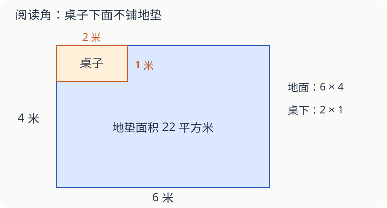

# 第 16 课：给校园阅读角做个方案

准备一个阅读角，会遇到面积、预算、分数和统计。题目长了，可以先找“要回答什么”，再选有关的数据。

## 先画草图，再找数量关系

阅读角地面长 6 米、宽 4 米。一张长 2 米、宽 1 米的桌子放在角上，桌子下面不铺地垫。

要铺的面积是 6×4−2×1＝22 平方米。如果地垫每平方米 15 元，需要 22×15＝330 元。面积与费用是两步不同的计算，写上单位就不容易混。

再看图书：书架上原有 80 本书，其中 3/8 是故事书。故事书有 80×3/8＝30 本。新添 20 本，全部是故事书，那么故事书变成 50 本，总数变成 100 本，占 50%。不能只给分子加 20、分母还留着 80。

## 自己完成这份方案

以下各题都不计材料损耗。遇到不同的新条件，按本题条件算。

1. 仍用配图布局。换成边长 0.5 米的正方形地垫，桌边与地垫边能对齐，不裁剪，需要几块？
2. 地垫每块 4 元，买满 80 块后全部按九折计价。第 1 题的地垫一共多少钱？
3. 原有 80 本书，其中故事书 30 本。另买多少本故事书，才能使故事书占全部图书的一半？先设想买 20 本，再检验。
4. 把 6 米长、4 米宽的地面画在比例尺为 1∶100 的图上，长、宽各画多少厘米？
5. 三组同学各读了 4、6、8 本书，三组人数依次是 2、3、5 人。全体同学平均每人读多少本？
6. 一个无盖收纳盒内部长 30 厘米、宽 20 厘米、高 15 厘米，容积是多少升？如果题目要算制作材料面积，还缺少怎样的说明？
7. 借阅登记显示，周一至周五的借阅本次依次为 12、18、15、20、15。五天一共多少本次？平均每天多少本次？能由此知道有多少本不同的书被借过吗？

## 答案与说明

1. 每块面积 0.5×0.5＝0.25 平方米，22÷0.25＝88 块。也可算整个地面 12×8 块，减去桌下 4×2 块，得 88 块。
2. 88×4×90%＝316.8 元。题目说的是全部地垫打折，不是只给超过 80 块的部分打折。
3. 20 本。买后故事书 50 本，总数 100 本，恰好一半。也可先看非故事书有 50 本，故事书要与它同样多，还差 20 本。
4. 长 6 厘米、宽 4 厘米。先把米化成厘米，再除以 100。
5. （4＋6＋8）÷（2＋3＋5）＝18÷10＝1.8 本。不能用三组总量的平均数当作每人的平均数。
6. 30×20×15＝9000 立方厘米＝9 升。算材料面积要知道是否忽略板材厚度、是否另计连接或粘贴部分；只给内部尺寸不能直接断定实际用料。
7. 共 80 本次，平均每天 16 本次。不能确定不同图书的本数，同一本书可能多次借出。
