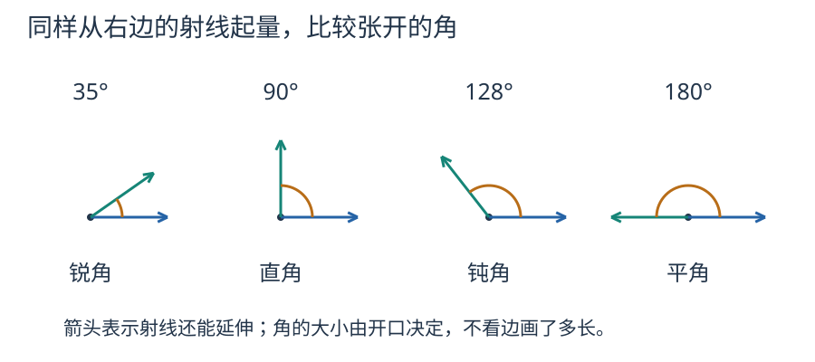

# 第 3 课：角度：1 度是谁定的？

1 度是把一圈平均分成 360 份，其中的 1 份。

## 怎样量出角的大小

角的大小，看两条边张开的程度。为了量它，人们把转一整圈分成 360 份，每份叫 1 度，记作 1°。

于是一圈是 360°，半圈是 180°，也就是平角；四分之一圈是 90°，也就是直角。

把一圈分成 360 份是角度单位的约定。360 能被 2、3、4 等数整除，所以半圈是 180°，三分之一圈是 120°，四分之一圈是 90°。这些计算说明这种分法便于使用，并不是说一圈只能分成 360 份。

先分清线的种类：线段有两个端点，可以量长度；射线有一个端点，向一边无限延伸；直线没有端点，向两边无限延伸。图上只能画它们的一部分，箭头表示还能继续延伸。

角由同一个端点引出的两条射线组成。大于 0°、小于 90° 是锐角；90° 是直角；大于 90°、小于 180° 是钝角。180° 是平角，不归入钝角。



把35°、90°、128°、180°分别画出来：它们依次是锐角、直角、钝角、平角。平角的两条射线方向相反。


量角时，把量角器的中心对准角的顶点，零刻度线对准角的一条边，看另一条边落在哪条刻度上。注意量角器有两圈刻度，要看清是从哪一边的 0 开始读。

试一试：① 画手电筒射出的光，常用线段、射线还是直线来表示？② 把 35°、90°、128°、180° 分类。答案：① 射线，表示从光源向一边延伸；② 锐角、直角、钝角、平角。这样画是为了表示光从哪里射出、朝哪个方向走，并不是说真实的光束能一直传到无限远。

钟面上也能找到这些角：一圈 360°，12 个大格，每格 30°；60 个小格，每格 6°。

## 动手短课：不读刻度，也能复制线段

准备直尺和圆规。先画一条线段 AB，再画一条从 C 出发的射线。把圆规两脚分别放在 A、B 上，保持张口不变；把针尖移到 C，另一脚在射线上画弧，交点记为 D。线段 CD 就和 AB 一样长。圆规搬过去的是两点之间的距离，直尺帮助把线画直。

试着画一个三角形，不读尺上的数值，把它的三条边依次搬到同一条射线上：先搬第一边，从它的终点接着搬第二边，再接第三边。起点到最后终点的线段长度，就是三角形的周长。最后用直尺核对；例如三条边分别是 3、4、5 厘米，拼接的总长应为 12 厘米。

**自己检查**：复制时圆规张口变小了，得到的新线段会怎样？三边拼接时为什么每次要从上一段终点开始？

<details>
<summary>看解释</summary>

张口变小，新线段就比原来短。依次从上一段终点接起，才能把三段长度相加，不留空隙也不重叠。操作圆规时让针尖朝纸面，用完收好。

</details>

## 动手短课：用三角尺画指定的角

准备一副三角尺。先找出 30°、60°、90° 的三个角，再找出另一块上的两个 45° 角。不要只凭三角尺摆放的方向认角，可以用量角器核对。

在纸上画射线 OA。要画 30°，把三角尺的 30° 顶点放在 O 上，让这个角的一条边贴着 OA，沿另一条边画射线 OB。移开三角尺，标出 30°。同样地，用 45°、60°、90° 的角分别再画三个角。三角尺提供的是两条边张开的程度，射线不必画得一样长。

**自己检查**：在每个角上写出度数，再用量角器核对。把纸转个方向，角度会变吗？如果顶点对准 O，却让三角尺的一条边离开 OA，沿另一边画出的角还能保证是指定角吗？

<details>
<summary>看核对方法</summary>

四个角应分别是 30°、45°、60°、90°；手工画图、读数可能有小误差，要检查顶点、边是否对齐。转动纸张不改变角度。一条边没有贴住 OA，就不能保证画出的角是指定角。

</details>

## 例子

### 例 1：钟面上的角

3:00 时，分针指向 12，时针指向 3，中间隔 3 个大格：

```
3×30° = 90°
```

5:00 时，中间隔 5 个大格：

```
5×30° = 150°
```

### 选学：2:20 的较小夹角

分针指向 4，从 12 起走了 20 个小格：

```
20×6° = 120°
```

时针不会一直停在 2。它每小时走一个 30° 的大格；20 分钟是 60 分钟的三分之一，所以又走了 30°÷3=10°：

```
2×30° + 30°÷3 = 60°+10° = 70°
```

两针相差：

```
120°−70° = 50°
```

### 例 3：用三角尺拼角

一副三角尺的角有 30°、60°、90° 和 45°、45°、90°。

把 30° 和 45° 拼在一起，得到 30°+45°=75°；把 60° 和 45° 拼在一起，得到 105°；把 90° 和 60° 拼在一起，得到 150°。

## 易错

- 量角器内外圈看反，把 50° 读成 130°。
- 以为角的两条边画得越长，角就越大。角的大小只看张开的程度，与边的长短无关。
- 算钟面角时只算分针，忘了时针也在走。2:20 不是 120°。
- 把平角 180° 和周角 360° 弄混。
- 量角时中心没有对准顶点，或者零刻度线没有和一条边重合。

## 练习

1. 周角、平角、直角分别是多少度？
2. 钟面上 5:00，时针和分针的夹角是多少度？
3. 一个角是 38°，它比直角小多少度？
4. 用 30° 和 45° 的角拼在一起，能得到多少度的角？
5. 【选做】钟面上 2:20，时针和分针的夹角是多少度？
6. 判断：角的两条边越长，角越大。

## 答案

1. 360°、180°、90°。
2. 5×30°=150°。
3. 90°−38°=52°。
4. 30°+45°=75°。
5. 分针 20×6°=120°；时针 2×30°+30°÷3=70°；夹角 120°−70°=50°。
6. 错。角的大小与边的长短无关。
