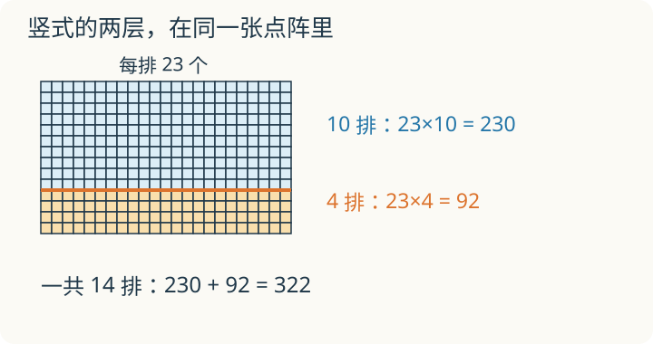

# 第 5 课：三位数乘两位数：两层积的秘密

123 个一排，排 24 排。先算 4 排，再算 20 排，得到的两部分为什么不能直接把末位对齐相加？

## 第二层的积为什么要错一位




123×24，可以拆成两部分：

```
123×24 = 123×4 + 123×20
```

先算 123×4=492，再算 123×20=2460，最后相加：

```
492+2460=2952
```

竖式就是把这两步叠起来写。

第二层算的是 123×2 个十，得到 246 个十，也就是 2460。所以 246 的末位要写在十位上，看起来就是向左错了一位。这一层算的是几个十，所以要从十位写起。

## 例子

### 例 1：145×27

```
      1 4 5
    ×   2 7
    ---------
    1 0 1 5       145×7
    2 9 0 0       145×20
    ---------
    3 9 1 5
```

- 145×7=1015；
- 145×20=2900；
- 1015+2900=3915。

所以 145×27=3915。

### 例 2：208×36

```
      2 0 8
    ×   3 6
    ---------
    1 2 4 8       208×6
    6 2 4 0       208×30
    ---------
    7 4 8 8
```

- 208×6=1248；
- 208×30=6240；
- 1248+6240=7488。

中间有 0 也要一位一位乘，0 乘任何数得 0，但这一位不能丢。

### 例 3：错在哪里

小明算 123×24，得到 738。

738 正好等于 123×6。他把第二层的 246 直接写在个位下面，没有错位，相当于只算了 123×6。正确结果是 2952。

## 易错

- 第二层积没有向左错一位，把 2460 写成了 246。
- 乘法进位后忘记加上进上来的数。
- 三位数中间有 0 时，漏乘这一位，导致后面全部错位。
- 两个因数末尾都有 0 时，先算完忘记把 0 补回去。
- 两层积相加时对错数位。

## 246 能代表多大的数

123×24 的第二层只写 246 时，怎样知道它代表 2460，而不是 246？

<details>
<summary>看解释</summary>

要看位置和它算的是什么。第二层算 20 排，也就是 2 个十排，得到 246 个十。末位的 6 写在十位上，代表 6 个十。省写末尾的 0，不能把数位也移走。

</details>

## 练习

1. 234×12 等于多少？
2. 306×25 等于多少？
3. 180×40 等于多少？
4. 145×27 的竖式中，第二层写出的 2900 表示多少？
5. 小明算 123×24 得 738，他错在哪里？
6. 一张桌子 125 元，买 32 张一共多少元？

## 答案

1. 234×10=2340，234×2=468，2340+468=2808。
2. 306×20=6120，306×5=1530，6120+1530=7650。
3. 18×4=72，再补两个 0，得 7200。
4. 表示 2900，也就是 290 个十。
5. 第二层没有错位，只算了 123×6。
6. 125×32=125×8×4=1000×4=4000 元。
