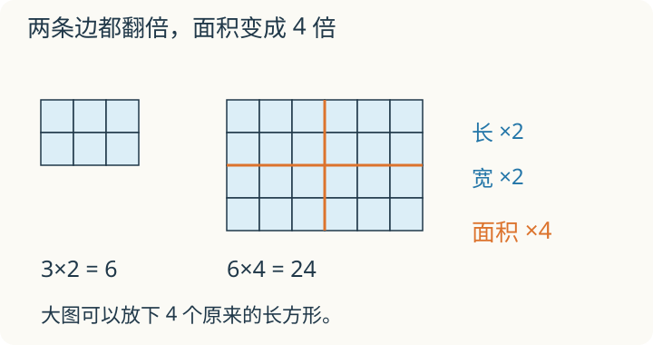

# 第 6 课：积的变化：谁在变，谁不变？

一个长方形，长变成原来的 2 倍，宽也变成原来的 2 倍。能放下几个原来的长方形？先画一画，再判断面积变成几倍。

## 份数变了，总数怎样变




乘法是把“每份多少”和“有几份”合起来。

12×3=36，表示 3 份，每份 12。

如果把 3 变成 30，就是份数乘 10，每份还是 12，总数自然也乘 10：

```
12×30 = 12×(3×10) = (12×3)×10 = 36×10 = 360
```

如果两个因数都乘 10，相当于每份和份数都乘 10，总数就乘 100：

```
120×30 = (12×10)×(3×10) = 36×100 = 3600
```

所以一个因数乘 a，另一个因数乘 b，积就乘 a×b。

反过来，一个因数乘 6，另一个因数除以 2，积就乘 6÷2=3。

## 例子

### 例 1：24×15=360

```
24×15 = 360
24×30 = 720      一个因数×2，积×2
48×15 = 720      一个因数×2，积×2
48×30 = 1440     两个因数都×2，积×4
```

### 例 2：一个乘 6，一个除以 2

12×8=96。

一个因数乘 6，变成 72；另一个因数除以 2，变成 4。

```
72×4 = 288
```

积从 96 变成 288，正好乘了 3，因为 6÷2=3。

### 例 3：长方形面积

长方形面积=长×宽。

长不变，宽乘 5，面积也乘 5。因为每一行还是那么长，行数变成了原来的 5 倍。

如果长乘 2、宽乘 3，面积就乘 6。

## 易错

- 两个因数都乘 2，以为积也乘 2。实际积乘 4。
- 一个因数乘 3，另一个因数除以 3，以为积变了。实际积不变。
- 把“一个因数乘几”当成“积加几”。12×5=60，把因数 5 变成 10，积变成 120，是乘 2，不是加 5。
- 求面积变化时，只看到一个因数变了，忘了另一个。
- 用加法算倍数变化。两个因数分别乘 2 和乘 3，积乘的是 2×3=6。

## 多 2，和乘 2 一样吗

一个 3×4 的点阵，把每行多放 2 个点，与把每行的点数变成原来的 2 倍，得到的总数一样吗？

<details>
<summary>看解释</summary>

不一样。原来每行 3 个，共 4 行。每行多 2 个，得到 5×4=20；每行变成 2 倍，得到 6×4=24。添两列只多了 8 个点，复制整个点阵才会让总数翻倍。

</details>

## 练习

1. 已知 15×24=360，直接写出 15×48、30×24、30×48 的积。
2. 已知 25×16=400，一个因数乘 4，另一个因数除以 4，积是多少？
3. 已知 12×35=420，一个因数乘 3，另一个因数不变，积是多少？
4. 已知 48×25=1200，一个因数乘 2，另一个因数除以 8，积是多少？
5. 长方形的长不变，宽乘 5，面积怎样变化？
6. 判断：两个因数都乘 2，积也乘 2。

## 答案

1. 15×48=720；30×24=720；30×48=1440。
2. 积不变，还是 400。
3. 420×3=1260。
4. 积乘 2÷8=1/4，1200÷4=300。
5. 面积也乘 5。
6. 错。两个因数都乘 2，积乘 4。
