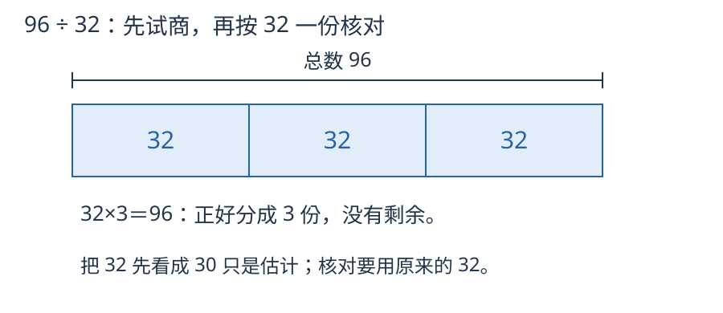

# 第 7 课：试商：为什么可以“猜”？

试商就是先猜一个接近的商，再乘回去检查；大了调小，小了调大。

## 先估一个商，再乘回去

除法是乘法的逆运算。要算 96÷32，就是问“32 乘几等于 96”。

直接把 32 当除数不好口算，就把它看成整十数 30。96 里面大约有 3 个 30，于是先猜商是 3。猜完必须检查：

```
32×3=96
```

正好相等，所以 96÷32=3。



把总数96平均画成3份，每份32。图中核对的是原除数32；不能因为估商时用了30，就按30算余数。


试商时，先用接近的整十数估一估，再用乘法检查。把除数看成整十数时：

- 把除数看小了（四舍），猜的商可能偏大；
- 把除数看大了（五入），猜的商可能偏小。

不管偏大还是偏小，都用“除数×商”去检查，再看余数。余数必须比除数小；如果余数还够再分一份，说明商小了，要加 1。

## 例子

### 例 1：96÷32

32 接近 30，96 里面大约有 3 个 30，猜 3。

```
32×3=96，余 0
```

所以 96÷32=3。

### 例 2：245÷37

37 接近 40，245 里面大约有 6 个 40，猜 6。

```
37×6=222
245−222=23
```

23 比 37 小，不能再分一份，所以 245÷37=6 余 23。

### 例 3：196÷39

39 接近 40，196 里面大约有 4 个 40，先猜 4。

```
39×4=156
196−156=40
```

余数 40 比除数 39 还大，说明还能再分 1 份。把商调成 5：

```
39×5=195
196−195=1
```

所以 196÷39=5 余 1。

### 例 4：商要写两位时，768÷24

先看 7 个百，不够分成 24 份，就看前两位 76 个十。把 76 个十平均分成 24 份，每份先得 3 个十，共分去 72 个十，所以商的十位写 3。剩下 4 个十，和原来的 8 个一合成 48 个一；48 个一再平均分成 24 份，每份得 2 个一，商的个位写 2。

```text
      3 2
    ─────
24 )7 6 8
    7 2       这里表示 72 个十
    ───
      4 8
      4 8
      ───
        0
```

768÷24=32。检验：24×32=768。

再看 612÷30：先用 61 个十除以 30，商十位写 2，减去 60 个十，剩 1 个十；和落下来的 2 个一合成 12 个一。不够再分一份，商的个位写 0，不能漏掉。所以商 20，余 12。检验：30×20+12=612，而且 12<30。

**自己练一练**：936÷24；630÷31。

<details>
<summary>看答案</summary>

936÷24=39；630÷31=20 余 10。检查：24×39=936，31×20+10=630，10<31。

</details>

## 易错

- 余数比除数大，还停在那里不调商。
- 把除数看成整十数后，直接把估算的商当成答案，不乘回去检查。
- 商的位置写错。除到哪一位，商就写在哪一位上面。
- 调商时只加 1，却忘了重新乘一遍、重新算余数。
- 看到“四舍”就以为商一定偏大，“五入”就以为商一定偏小。只是“可能”，仍要检查。

## 商为什么正好是 6

245÷37，算出 37×6=222 还不够。再算 37×7=259，能说明什么？

<details>
<summary>看解释</summary>

222≤245<259。能装满 6 份，却不够装满 7 份，因此商是 6；剩下 245−222=23，比一份的 37 少。

</details>

## 练习

1. 128÷32 等于多少？
2. 215÷43 等于多少？
3. 187÷29 等于多少？
4. 250÷38 等于多少？
5. 一个数除以 42，商是 7，余数是 5，这个数是多少？
6. 判断：试商时把 38 看成 40，初商一定正确。

## 答案

1. 32×4=128，商 4。
2. 43×5=215，商 5。
3. 29×6=174，187−174=13，商 6 余 13。
4. 38×6=228，250−228=22，商 6 余 22。
5. 42×7+5=294+5=299。
6. 错。把除数看大了，初商可能偏小，还要检查余数。
