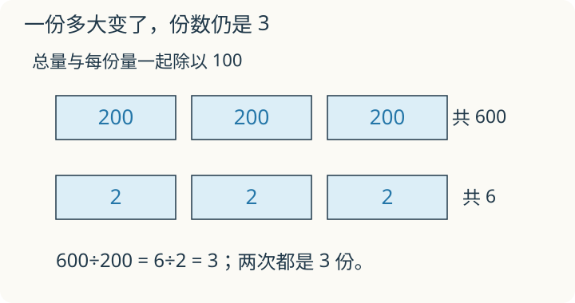

# 第 8 课：商不变：一起变，为什么商不变？

600 颗糖，每 200 颗一袋，装 3 袋。把总量和每袋的数量都除以 100，变成 6 颗、每 2 颗一袋，为什么仍是 3 袋？

## 糖变少了，袋数为什么没变



这张图只比较分成几份；上下方块画得同样大，不表示 600 和 6 是同样多的糖。

600÷200，可以想成“600 颗糖，每 200 颗装一袋，能装几袋”。

600 颗装 3 袋，因为 200×3=600。

现在把糖和每袋的数量同时缩小 100 倍：6 颗糖，每 2 颗装一袋，还是 3 袋。

```
600÷200 = 6÷2 = 3
```

总量和每份的大小一起变，份数没有变，所以商不变。

用算式看：

```
600÷200 = (600÷100)÷(200÷100) = 6÷2
```

被除数和除数同时乘同一个不为 0 的数，也是同样的道理。同时除以的数也不能是 0。本课在整数除法中使用这个方法时，要让两边都能整除。

要注意的是：商不变，余数不一定不变。余数是“分完后剩下多少”，它跟着被除数的单位走。

## 例子

### 例 1：4800÷600

被除数和除数同时除以 100：

```
4800÷600 = 48÷6 = 8
```

### 例 2：360÷45

直接算不好算，可以把被除数和除数同时除以 9：

```
360÷45 = 40÷5 = 8
```

检验：45×8=360。

### 例 3：850÷30 的余数

先同时除以 10：

```
850÷30 = 85÷3
```

85÷3=28 余 1。

但这个余数 1 是在把被除数和除数都除以 10 以后得到的，它也跟着缩小了 10 倍。原来的余数应是：

```
1×10=10
```

所以原来的算式：

```
850÷30 = 28 余 10
```

检验：30×28+10=840+10=850。

## 易错

- 只把被除数乘或除，除数没动，商就变了。
- 同时乘 0。除数不能是 0，所以不能同时乘 0。
- 以为商不变，余数也不变。850÷30 的余数是 10，不是 1。
- 竖式里划掉末尾的 0 后，把新余数直接当成原题的余数，忘记补回被划掉的 0。
- 同时加或同时减一个数，以为商不变。商不变靠的是乘除，不是加减。

## 同加 2 行不行

6÷2=3。总量和每份数量都加 2，变成 8÷4，还能装 3 份吗？试着画出每袋的糖。

<details>
<summary>看解释</summary>

只能装 2 份。每袋从 2 颗变成 4 颗，翻了一倍；总量从 6 颗到 8 颗没有翻倍。两种量没有按同一个倍数变化，份数就不保持原来的 3。

</details>

## 练习

1. 720÷80 等于多少？
2. 2400÷400 等于多少？
3. 已知 36÷4=9，写出 360÷40 和 3600÷400 的商。
4. 480÷60=8。如果被除数和除数都乘 5，商是多少？
5. 730÷20 等于多少？余数是多少？
6. 判断：被除数和除数同时加 10，商不变。

## 答案

1. 72÷8=9。
2. 24÷4=6。
3. 都是 9。
4. 商不变，还是 8。
5. 73÷2=36 余 1，余数 1 表示 1 个十，所以 730÷20=36 余 10。
6. 错。同时加同一个数，商通常会变。
