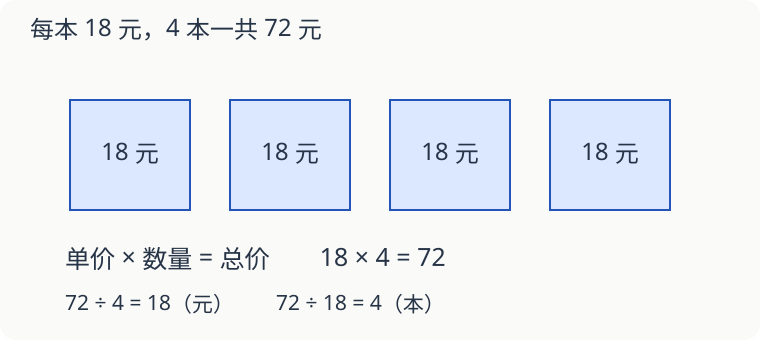

# 第 13 课：先认清每个数在说什么

每盒彩笔 18 元，买了 4 盒。算 `18×4` 前，先把这两个数读完整：每盒 18 元，买 4 盒。

## 每份多少，乘上有几份

单价是每件商品的价格，数量是买了几件，总价是这些商品一共花多少钱。同种商品单价不变时：

`单价×数量=总价`。



图里换成了每本 18 元的 4 本书；每份 18 元、共 4 份的关系，与买彩笔相同。

`18×4=72（元）`。反过来，72 元买了 4 盒，求每盒价格是 `72÷4=18（元）`；每盒 18 元，72 元能买几盒是 `72÷18=4（盒）`。两道除法的答案单位不同，因为问的量不同。

## 先求一份，还是先求全部

同种本子 3 本卖 18 元，没有折扣。买 5 本多少钱？先求一本 18÷3=6 元，再求五本 6×5=30 元，合起来是 `18÷3×5=30（元）`。先找“一份”，有时叫归一。价格相同，才能这样换算。

再看装铅笔：3 盒，每盒 8 支。把这些铅笔全部改成每盒 6 支，可以装几盒？这次先求全部有 3×8=24 支，再求 24÷6=4 盒。先找“总共多少”，有时叫归总。

```text
买本子：3 本的价钱 → 一本的价钱 → 5 本的价钱
装铅笔：3 盒的支数 → 全部的支数 → 每盒 6 支的盒数
```

不用先猜题型名字。说清每一步求的是元、支还是盒，算式就容易写对。

**试一试**：① 同种本子 4 本 28 元，单价不变，9 本多少钱？② 5 包贴纸，每包 12 张，全部改装为每包 10 张，能装几包？

**核对**：① 28÷4×9=63 元。② 5×12÷10=6 包。前一题先求一本的价钱，后一题先求全部贴纸的张数。

## 每分钟走的路，乘上走的分钟数

小林每分钟走 60 米，保持这个速度走 8 分钟。每分钟走的路叫速度，8 分钟是时间，总路程是 `60×8=480（米）`。

算速度时用 `路程÷时间`。480 米用 8 分钟走完，平均每分钟 60 米。如果中途时快时慢，这只是平均速度，不能说每分钟都恰好走了 60 米。

## 先统一单位，再找关系

每小时行 12 千米，半小时不能直接算 `12×30`。30 的单位是分钟，与“每小时”不一致。半小时是一小时的一半，路程是 `12÷2=6（千米）`。

同样，3 盒彩笔和 2 本书不能直接合成“5 件，每件 18 元”，除非题目说明它们单价相同。

## 只想知道够不够，可以先估

带 200 元买 9 盒彩笔，每盒 18 元，钱够吗？每盒按更贵的 20 元算，9 盒也只要 20×9=180 元，所以 200 元一定够，不必先算准确总价。这里把价钱估大，是为了给出一个不超过 200 元的上限；如果估成 20 元买 11 盒得到 220 元，就不能据此说钱一定不够，实际 18×11=198 元，仍然够。

## 同样的重量，可以互相替换

天平称出一袋米和 3 块同样的砝码一样重，又称出一袋豆子也和这 3 块砝码一样重。把米和豆子放到天平两边，会平衡吗？

会。米的重量等于这 3 块砝码的总重量，豆子的重量也等于它；所以这袋米和这袋豆子一样重。这叫“等量的等量相等”。比较的是重量，不能据此说米粒和豆子的颗数一样多。

**试一试**：红绳和蓝绳一样长，蓝绳和绿绳一样长。红绳与绿绳一样长吗？如果只是红绳比蓝绳长、绿绳也比蓝绳长，还能判断红绿两绳一样长吗？

<details>
<summary>看解释</summary>

第一种能，两条绳都和同一条蓝绳一样长。第二种不能：例如蓝绳 2 米，红绳 3 米、绿绳 4 米，两条都比蓝绳长，彼此却不一样长。

</details>

## 自己试一试

1. 每本练习本 7 元，买 8 本多少钱？
2. 96 元买了 6 个相同的笔袋，每个多少元？
3. 一种球每个 24 元，120 元能买几个？
4. 每分钟走 75 米，保持速度走 6 分钟，走了多少米？
5. 600 米走了 10 分钟，平均速度是多少？
6. 自行车每小时行 16 千米，保持这个速度骑 30 分钟，行了多少千米？

## 答案与说明

1. `7×8=56（元）`。
2. `96÷6=16（元）`。
3. `120÷24=5（个）`。
4. `75×6=450（米）`。
5. `600÷10=60（米/分）`，读作每分钟 60 米。
6. 30 分钟是半小时，`16÷2=8（千米）`。
