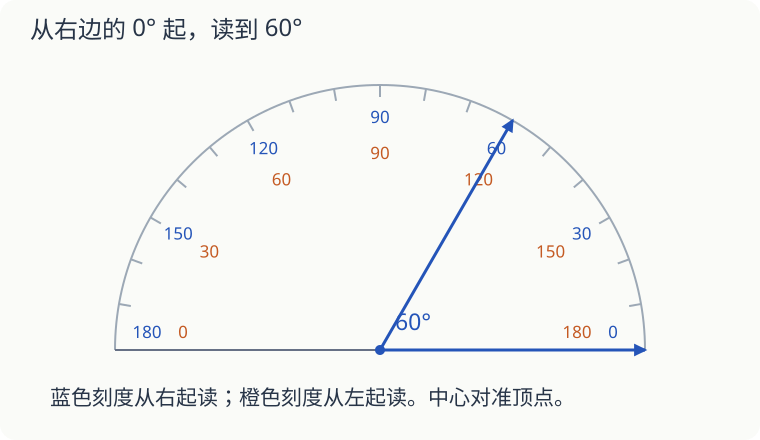

# 第 14 课：量角器从哪边读

同一条刻度线旁边，为什么既写着 60，又写着 120？量角器让你能从左边量，也能从右边量。要先找到角的一条边对着哪个 0。

## 中心和起点都要对准

图中角的一条边从顶点向右，所以从右边的 0° 读起。另一条边到 60° 刻度，角就是 60°。

若从左边的 0° 开始数，读到的是 120°。那是另一边与这条斜线的夹角，不是这道题要量的角。

量的时候依次检查：中心是否对顶点，0° 线是否沿着一条边，读的是否是从这边 0° 开始的刻度。最后看看结果是否合理：看起来明显小于直角，却读成 120°，就该检查内外圈。

## 画 70° 的角

先画一条射线，把量角器中心对准它的端点，0° 线与射线重合。从这条射线所在的 0° 起找到 70°，点一个小点。拿开量角器，连接端点和这个点，再向外延长，就画好了另一条边。

量角器的半圆边不能当成角的边。角的两条边都是从同一顶点发出的直射线。

## 拼在一起的角，才可以相加

两个角共用顶点和一条边，开口不重叠时，把开口拼在一起，度数可以相加。30° 与 45° 这样拼，得到 75°。若两个开口重叠，就不能把重叠处数两次。

## 自己试一试

1. 配图中蓝色角应该读 60° 还是 120°？为什么？
2. 一个角的一条边向左，另一条边落在“从左起 40°、从右起 140°”的位置，角多大？
3. 用量角器画一个 70° 的角，标出顶点和度数。
4. 画一个 110° 的角，和直角比较，它是哪类角？
5. 35° 与一个角不重叠地拼成直角，另一个角多少度？
6. 把 80° 的角一条边画长，量角器量出的角度会变吗？

## 答案与说明

1. 60°，从向右的边对准的 0° 起读。
2. 40°，从左边的 0° 起读。
3. 两条边共一个端点，从起始射线量到另一条边应是 70°。可重新放好量角器核对；本题不要求边长固定。
4. 钝角，110° 大于 90°、小于 180°。按上一题的方法量回去检查。
5. `90°−35°=55°`。
6. 不变，开口没有变化。
