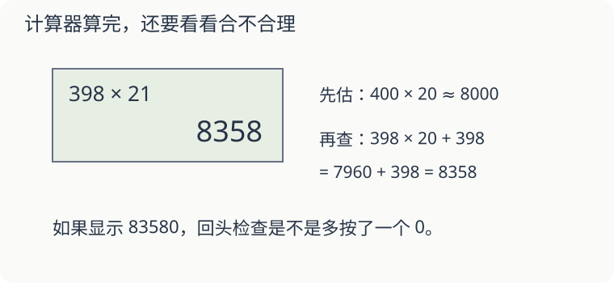

# 第 15 课：计算器给出的数，能直接相信吗

小明想算 `398×21`，屏幕却显示 83580。先检查有没有多按一个 0，或抄错屏幕上的数。

## 先估一下结果有多大

398 接近 400，21 接近 20，积应在 8000 附近。83580 大了很多，先检查输入。

重新按 `398×21`，得到 8358。用另一种算法检查：`398×20+398=7960+398=8358`。

开始新题前先清除上一题。不同计算器的清除键、退格键可能不同，照着键上的标记或说明使用，不能假定每台都一样。

## 看见规律，再解释规律

用计算器算：

| 算式 | 结果 |
|---|---:|
| 123×9 | 1107 |
| 123×99 | 12177 |
| 123×999 | 122877 |

这些结果不是随便排列的。`123×99=123×(100−1)=12300−123`。用“乘一个整百，再减去一份”就能解释第二行。

想算 `456×99`，可以先想 `45600−456=45144`，再用计算器核对。只抄出几个结果，还没有说明规律为什么成立。

## 混合运算要留心按键方式

有些简易计算器按按键顺序立即计算，有些会先乘除。计算 `2+3×4` 时，可靠的做法是先算 `3×4=12`，再算 `2+12=14`；若使用括号或表达式输入，先确认这台计算器的用法。

## 自己试一试

1. 算 `203×19` 得到 38570，结果合理吗？先估，再算正确值。
2. 用 `250×100−250` 检查 `250×99`，结果多少？
3. 算 `7200÷30`，得到 24。用乘法怎样检查？正确商是多少？
4. 用计算器记录 `37×3`、`37×6`、`37×9`。为什么结果每次多 111？
5. `5+6×7` 应先输入哪一部分，才能不依赖计算器的运算优先级？

## 答案与说明

1. 不合理，约为 `200×20=4000`。正确值 `203×20−203=4060−203=3857`。
2. `25000−250=24750`。
3. `24×30=720`，不是 7200，所以商错了；正确商是 240。
4. 111、222、333。第二个因数每次增加 3，就多了 3 份 37，即 111。
5. 先算 `6×7=42`，再加 5，得 47。
