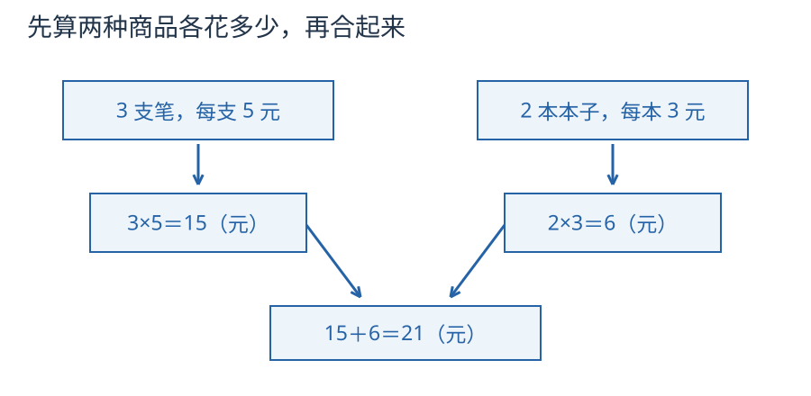

# 第 1 课：运算顺序

3 支笔每支 5 元，2 本本子每本 3 元。小票上可以写 3×5+2×3。这里的两个乘法，分别在算哪一笔钱？

## 购物小票里的先后顺序

乘法是“几个相同的数合起来”。3×5 表示 3 个 5，先把它算成 15，才能和别的数量相加。

看购物小票：3 支笔，每支 5 元；2 本本子，每本 3 元。总价是 3×5+2×3。两个乘法各自表示一种商品的总价，必须先把它们分别算出来，再相加：15+6=21。

如果从左往右算，先算 3×5=15，再加 2 得 17，最后乘 3 得 51。这个 51 不表示这张小票的总价；它相当于把“15 加 2”重复了 3 次，已经换了数量关系。大家按同样的次序算，同一个算式才能得到同一个结果。

这张小票里，先乘出笔和本子各花多少钱，再把两笔钱加起来，正好对应“先乘除，后加减”的顺序。

两个乘法分别算笔钱和本子钱；最后的加法才把两笔钱合起来。

括号的作用是改变次序。括号里的内容先算。括号套括号时，从最里面算起。

小括号外还需要一层括号时，可以用中括号。例如 `72÷[3×(6−2)]`，先算小括号里的 `6−2=4`，再算中括号里的 `3×4=12`，最后算 `72÷12=6`。每一步都把还没算的部分照写下来。

**试一试**：`96÷[2×(7−3)]` 的三步依次是什么？

看答案

先算 `7−3=4`，再算 `2×4=8`，最后算 `96÷8=12`。可以写成 `96÷[2×4]=96÷8=12`。

## 例子

### 例 1：3×5+2×3

先算两个乘法：

3×5=15，2×3=6。

再算加法：15+6=21。

### 例 2：36÷(6−3)×2

先算括号：6−3=3。

原式变成 36÷3×2。除法和乘法同级，从左往右：

36÷3=12，12×2=24。

### 例 3：100−20×3+10

先算乘法：20×3=60。

原式变成 100−60+10。减法和加法同级，从左往右：

100−60=40，40+10=50。

不能先算 60+10=70，再算 100−70=30。加号在减号后面，不能抢到前面。

## 易错

- 以为“先乘除”就是乘法一定排在除法前面。乘除同级，从左往右。24÷4×3 先算 24÷4=6，再乘 3 得 18，不是 24÷12=2。
- 括号没有先算。36÷(6−3) 先算 6−3，不是先算 36÷6。
- 减法后面的乘法被忽略。18−3×4 先算 3×4=12，再算 18−12=6，不是 (18−3)×4。
- 同级运算跳着算。100−60+10 要从左往右，不能先算 60+10。
- 脱式时把没算到的数漏写，或者把运算符号抄错。

## 练习

1. 18−3×4
2. (18−3)×4
3. 24÷6×2
4. 24÷(6×2)
5. 在 2+3×4 里加一对括号，使结果是 20。

## 答案

1. 18−12=6。
2. 15×4=60。
3. 4×2=8。
4. 24÷12=2。
5. (2+3)×4=5×4=20。
