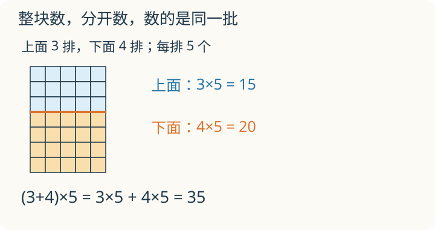

# 第 2 课：运算律

一张点阵图，可以横着数，也可以竖着数；可以整块数，也可以切成两块数。点一个没添、一个没少，哪些算式会得到同一个总数？

## 换一种算法，结果为什么相同

先看加法。3+5 和 5+3 都是把同一堆东西合起来，只是数的顺序不同，结果都是 8。

乘法也一样。3×4 可以摆成 3 行 4 列，转 90° 就是 4 行 3 列，棋子总数还是 12。所以 a×b=b×a。

结合律改变的是分组。算 (2+3)+4，先得 5，再加 4 得 9；算 2+(3+4)，先得 7，再加 2 得 9。三个数最终都合在一起，先合哪两个不影响总数。

把 24 个小方块放进 2 个盒子，每盒 3 排、每排 4 个。先数排数，有 2×3=6 排，再算每排 4 个，得到 (2×3)×4；先数每盒有 3×4=12 个，再数 2 盒，得到 2×(3×4)。两种数法都把原来的小方块数了一遍，没有新增或漏掉哪一块。

分配律稍微不同。看 (3+4)×5：括号里先合起来是 7 份，每份 5 个，共 35 个。也可以分开算：3 份是 15 个，4 份是 20 个，合起来还是 35 个。写成算式：

(3+4)×5=3×5+4×5。

用字母表示：

- 加法交换律：a+b=b+a；
- 乘法交换律：a×b=b×a；
- 加法结合律：(a+b)+c=a+(b+c)；
- 乘法结合律：(a×b)×c=a×(b×c)；
- 乘法分配律：(a+b)×c=a×c+b×c。

交换律和结合律只对加法和乘法成立。8−3=5，3−8 不够减，不能交换；20÷5×2 也不能随便写成 20÷(5×2)。

## 例子

### 例 1：37+58+42

58 和 42 能凑成 100，先把它们结合起来：

37+58+42=37+(58+42)=37+100=137。

### 例 2：25×17×4

25×4=100，先交换再结合：

25×17×4=(25×4)×17=100×17=1700。

### 例 3：99×36+36

前面是 99 份 36，后面还有 1 份 36，合起来正好 100 份：

99×36+36=99×36+1×36=(99+1)×36=100×36=3600。

## 易错

- 分配律漏乘。25×(4+8)=25×4+25×8=100+200=300，不是 25×4+8=108。
- 提取公因数时把乘号写成加号。99×36+36=(99+1)×36，不是 (99+1)+36。
- 交换律、结合律乱用到减法和除法上。8−3=5，3−8 不够减；20÷5×2 不等于 20÷(5×2)。
- 乘法结合律不是把两个括号相乘。25×4×8 可以写成 25×(4×8)，不能写成 (25×4)×(25×8)。
- 分配律对减法也成立：(7−3)×5=4×5=20，7×5−3×5=35−15=20。

## 少乘的部分在哪儿

把 7 行、每行 5 个的点阵分成上面 3 行和下面 4 行。有人写成 (3+4)×5=3×5+4。请在图里找出他没数到的点。

看解释

上面 3 行的 15 个都数了，下面却只算了 4 个，相当于每行只数 1 个。下面每行还漏了 4 个，共漏 16 个。下面也得算 4×5，才是整张图的 35 个。

## 练习

1. 37+58+42
2. 25×17×4
3. 36×99+36
4. 15×8+15×2
5. 判断：20÷5×2=20÷(5×2) 吗？分别计算。
6. 用分配律算 (20+4)×25。

## 答案

1. 37+(58+42)=37+100=137。
2. (25×4)×17=100×17=1700。
3. 36×(99+1)=36×100=3600。
4. 15×(8+2)=15×10=150。
5. 不相等。左边 20÷5×2=4×2=8；右边 20÷(5×2)=20÷10=2。
6. 20×25+4×25=500+100=600。
