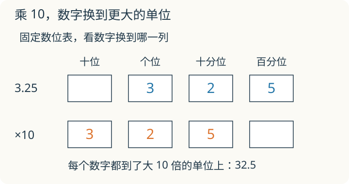

# 第 5 课：小数点搬家

本课是后续选学，建议掌握[小数意义](../L04-小数意义/讲授稿.md)后学习。多位小数的意义、运算与性质按 2022 年课标属于五至六年级内容。小数加减和求近似数可以分两次学。

3.25 里的 3 表示 3 个一。如果把整个数乘 10，这个 3 应该放到哪个数位？把数字卡放进数位表里看一看。

## 3.25 乘 10，每一位怎样变




看 3.25：

- 3 在个位，表示 3 个一；
- 2 在十分位，表示 2 个 0.1；
- 5 在百分位，表示 5 个 0.01。

乘 10 后，每个数位都升一级：3 个一变成 3 个十，2 个 0.1 变成 2 个一，5 个 0.01 变成 5 个 0.1。结果是 32.5。数字 3、2、5 的排列没变，小数点向右移了一位。

再乘 10，32.5 变成 325；再乘 10，325 变成 3250。小数点每右移一位，就是乘 10。反过来，每左移一位，就是除以 10。

乘 10 要看每个数字所在的数位，不能只在末尾添 0。3.25×10=32.5，没有多出 0；3.2×100=320，这里的 0 是因为 3.2 只有一位小数，小数点右移两位后需要补一个 0 占位。2.5÷100=0.025，小数点左移两位，位数不够，要用 0 占位。

单位换算也会用到乘除 10、100、1000，但要注意：换单位时，实际的长度没变，只是表示长度的数值变了。

1 米=10 分米=100 厘米=1000 毫米。

1.2 米=12 分米=120 厘米=1200 毫米。

## 例子

### 例 1：3.25 乘 10、100、1000

3.25×10=32.5

3.25×100=325

3.25×1000=3250

每乘一次 10，小数点向右移一位；位数不够时补 0。

### 例 2：2.5 除以 10、100、1000

2.5÷10=0.25

2.5÷100=0.025

2.5÷1000=0.0025

每除以一次 10，小数点向左移一位；前面不够就补 0。

### 例 3：1.2 米换成小单位

1.2 米=12 分米=120 厘米=1200 毫米。

米换分米乘 10，换厘米乘 100，换毫米乘 1000。

## 易错

- 以为乘 10 就是末尾添一个 0。3.25×10=32.5，不是 3.250。
- 方向弄反。乘 10 向右移，除以 10 向左移。
- 位数不够不补 0。2.5÷100=0.025，不是 0.25。
- 只看小数点，不看数字。0.08×1000：依次乘 10 得 0.8、8、80，结果是 80。
- 单位换算时乘除方向错。米换厘米要乘 100，厘米换米要除以 100。
- 小数中间有 0 时，不要把它丢掉。3.06 米=306 厘米，不是 36 厘米。

## 另一次短课：小数加减与估算检查

先会三下 06 的一位小数加减，再做这里的多位小数。加减时按数位对齐，也就是小数点对齐；末尾补 0 不改变数的大小。

算 3.47+2.8，先把 2.8 写成 2.80：

```text
   3.47
 + 2.80
 ------
   6.27
```

百分位 7+0=7；十分位 4+8=12，写 2 进 1；个位 3+2+1=6。3.47 接近 3.5，2.8 接近 3，结果约 6.5，所以 0.627 太小、62.7 太大，都不可能是这道题的答案。

算 5−2.36，先写成 5.00。个位借 1 给十分位，十分位再借 1 给百分位：百分位 10−6=4；十分位剩 9，9−3=6；个位剩 4，4−2=2，所以得 2.64。用 2.64+2.36=5.00 检查。

**自己练一练**

1. 4.08+0.7；
2. 10−3.85；
3. 买本子花 6.75 元、买笔花 2.8 元，付 10 元，找回多少元？
4. 小明写 2.35+0.6=2.41，他对错了哪一位？

**答案与解释**

1. 4.78；
2. 6.15；
3. 10−(6.75+2.80)=10−9.55=0.45 元；
4. 把十分位的 6 错放在百分位，正确是 2.35+0.60=2.95。

## 另一次短课：小数近似数

保留一位小数，要看百分位：3.46≈3.5；保留两位小数，要看千分位：3.464≈3.46。只按要求保留的位置看下一位，使用“≈”，不要把近似数写成与原数相等。

**自己练一练**

1. 9.96 保留一位小数；
2. 2.304 保留两位小数；
3. 为什么 2.30 不能在“保留两位小数”的答案里简写成 2.3？

**答案与解释**

1. 10.0，十分位进位后还要保留一位小数；
2. 2.30；
3. 两个数的值相同，但 2.30 表明结果保留到了百分位。

## 这两种变化一样吗

1.2×10=12，与 1.2 米=12 分米，都出现了 1.2 和 12。它们有什么不同？

<details>
<summary>看解释</summary>

前一个把数变成了原来的 10 倍。后一个说的是同一段长度，换用更小的单位“分米”，需要的单位数是原来的 10 倍；尺子本身没有变长。

</details>

## 练习

1. 4.6×10；4.6÷10。
2. 0.35×100；0.35÷100。
3. 2.7×1000；2.7÷1000。
4. 3.06 米等于多少厘米？
5. 已知 1 升=1000 毫升，480 毫升等于多少升？
6. 把 0.5 的小数点向右移动两位，得到多少？是原来的几倍？

## 答案

1. 46；0.46。
2. 35；0.0035。
3. 2700；0.0027。
4. 306 厘米。
5. 0.48 升。
6. 50；100 倍。
