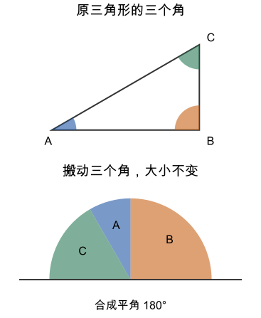

# 第 7 课：内角和

本课建议在五至六年级学习，四年级可作为拼角选学。先会量角、认识平角，能按边和角给三角形分类。2022 年课标把内角和列在第三学段，不以本目录的“四下”认定同步进度。

任意三角形的三个内角加起来都是 180°；把三个角搬到一起，可以直观看到它们拼成一个平角。

## 把三个角拼到一起

先看下面的示意图。给三角形的三个角分别涂色，再把它们搬到同一个顶点旁边，保持每个角的张口大小不变，依次拼接。

三个角合在一起，两条外侧边落在同一直线上，形成平角。平角是 180°，因此这幅图中三个内角的和是 180°。换成锐角、直角或钝角三角形，做同样的观察，也会看到这个现象。

拼几个三角形的角，能帮助我们看懂这个结论。不过，只看这几个，还不能证明所有三角形都这样。这节课先用“三角形内角和为 180°”来计算，以后学了平行线的角的关系，再来证明它。

由此可以推出：

- 已知两个角，第三个角=180°−两个角的和；
- 直角三角形里，两个锐角的和是 90°；
- 等边三角形每个角都是 180°÷3=60°；
- 四边形可以连一条对角线分成两个三角形，内角和是 180°×2=360°。

## 例子

### 例 1：已知两个角

三角形两个角是 50° 和 60°，第三个角是：

180°−50°−60°=70°。

### 例 2：直角三角形

直角三角形有一个角是 90°，一个锐角是 35°，另一个锐角是：

180°−90°−35°=55°。

也可以直接算 90°−35°=55°。

### 例 3：等腰三角形

先沿顶点到底边中点对折等腰三角形，两条腰重合，两个底角也重合，因此底角相等。等边三角形任选两条边都相等，三个角也都相等。

等腰三角形的顶角是 40°，两个底角相等：

(180°−40°)÷2=140°÷2=70°。

每个底角是 70°。

## 易错

- 把 180° 当成每个角。三角形可以三个角都不同，和才是 180°。
- 以为三角形画得越大，内角和越大。角的大小与边长无关，内角和始终是 180°。
- 已知两个角，用 360° 去减。三角形用 180°，四边形才用 360°。
- 等腰三角形求底角，忘了先减顶角再除以 2。
- 认为直角三角形可以有两个 90°。两个 90° 已经是 180°，第三个角变成 0°，不可能。
- 把外角当内角。外角和相邻的内角相加是 180°，不是三角形的内角和。

## 练习

1. 三角形两个角是 45° 和 65°，第三个角是多少？
2. 直角三角形的一个锐角是 28°，另一个锐角是多少？
3. 等腰三角形的顶角是 80°，每个底角是多少？
4. 三角形两个角是 90° 和 50°，第三个角是多少？
5. 判断：三角形三个角可能是 40°、60°、90° 吗？
6. 四边形内角和是多少度？

## 答案

1. 180°−45°−65°=70°。
2. 90°−28°=62°。
3. (180°−80°)÷2=100°÷2=50°。
4. 180°−90°−50°=40°。
5. 不可以。40°+60°+90°=190°，超过 180°。
6. 360°。连接一条对角线，分成两个三角形，180°×2=360°。
