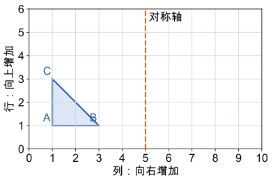

# 第 8 课：图形运动

平移只改位置，旋转绕一个点转，轴对称沿一条线翻折；三种运动都不改变图形的形状和大小。

## 平移、旋转和轴对称，各是怎样动的

平移：图形上每个点都朝同一方向移动同样的距离。像电梯上下、推拉窗左右。对应点之间的方向一致，距离相等，图形不会转头。

旋转：图形绕一个固定点转动一个角度。像钟表指针、风扇叶片。要说明三件事：绕哪个点、朝哪个方向（顺时针或逆时针）、转多少度。转 90°、180°、270° 后，形状和大小不变，方向变了。

轴对称：沿一条直线对折，直线两边的图形完全重合。这条直线叫对称轴。对称轴是一条直线，不是图形里面的一条线段。对应点到对称轴的距离相等，连线与对称轴垂直。

这样移动图形，任意两点之间的距离都没变，边长、角的大小和面积也没变。改变的只是图形的位置或朝向。

## 例子

### 例 1：平移

方格图中的一个三角形，每个顶点都向右移 4 格，再向下移 2 格。移动后，三条边的长度不变，三个角的大小不变，只是整个图形换了位置。

平移的距离要数“对应点走了几格”，不是数两个图形中间空了几格。

### 例 2：旋转

钟面上的指针从 12 指向 3，是绕中心顺时针旋转 90°；从 12 指向 6，是旋转 180°；转一圈 360°，回到原处。

一个图形绕中心顺时针转 90°，连续转 3 次，一共转 270°。

### 例 3：对称轴

非正方形的长方形有 2 条对称轴，分别经过两组对边的中点。

正方形有 4 条对称轴：两条经过对边中点，两条沿对角线。

一般的等腰三角形有 1 条对称轴，等边三角形有 3 条；圆有无数条对称轴。

## 易错

- 平移数格子时，数两个图形之间的空格，而不是数对应点移动了几格。应找一组对应点来数。
- 旋转只转图形的一部分，或者忘了说旋转中心和方向。
- 把轴对称当成“左右一样”。对称要求沿对称轴翻折后完全重合，位置、距离都要对。
- 没看长和宽是否相等就回答对称轴数量。非正方形的长方形有 2 条；正方形是特殊的长方形，有 4 条。
- 认为平移或旋转后面积变了。三种运动都不改变面积。
- 画对称图形时只连了顶点，没有检查对应点到对称轴的距离。

## 在方格图上独立画

图中数字表示网格线：从左向右是第几列，从下向上是第几行，交点位置按列、行一起找；0 是起始线。每一小格边长相同，A 在第 1 列第 1 行，B 在第 3 列第 1 行，C 在第 1 列第 3 行。

1. 把原三角形向右平移 4 格，再向上平移 1 格，画出三个对应顶点并连接。
2. 另用一种颜色，画原三角形关于竖直虚线的对称图形。两题都从原图出发。
3. 小明把第 1 题的 B 点向右移了 3 格，另两点都移 4 格，结果还是原图的平移吗？说明理由。

核对：平移后三点分别在第 5 列第 2 行、第 7 列第 2 行、第 5 列第 4 行。对称后三点分别在第 9 列第 1 行、第 7 列第 1 行、第 9 列第 3 行。第 3 题不是，因为各点移动的方向和距离必须相同。画完后，检查对应点移了几格、离对称轴几格，再看看整个图形是否画对。只写“大小不变”，还不能说明画对了。

## 练习

1. 一个点先向右平移 5 格，再向左平移 2 格，最终相当于向右平移几格？
2. 图形绕中心顺时针旋转 90°，连续转 3 次，一共转了多少度？
3. 长和宽不相等的长方形有几条对称轴？
4. 正方形有几条对称轴？
5. 钟面上的指针从 12 转到 3，绕中心顺时针旋转了多少度？
6. 一个三角形面积是 12 平方厘米，平移后面积是多少？

## 答案

1. 5−2=3，向右 3 格。
2. 90°×3=270°。
3. 2 条。
4. 4 条。
5. 90°。
6. 12 平方厘米，平移不改变面积。
