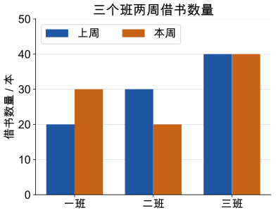

# 第 9 课：平均数

平均数=总数÷份数。它表示把总数平均分开，每份有多少。如果有一个数特别大或特别小，平均数也会受影响。

## 如果每个人分得一样多

三个同学分别有 2、4、9 块积木。一共 2+4+9=15 块，平均分给 3 人，每人 15÷3=5 块。

可以这样移：

9 块的同学拿出 3 块给 2 块的同学，变成 6 块和 5 块；6 块的同学再拿 1 块给 4 块的同学，变成 5 块和 5 块。最后三人都是 5 块。

平均数 5 并不表示每个人都真的有 5 块，原来没有人是 5 块。它表示的是一种“如果平均分，每人会得到多少”的水平。总数没变，份数没变，所以平均数也不变。

平均数不会小于最小的数，也不会大于最大的数。但一个特别大或特别小的数，就能改变平均数：

90、90、90、90、0 的平均数是 (90×4+0)÷5=360÷5=72。大多数人是 90，但一个 0 把平均数拉到了 72。所以，知道平均数以后，还要看看原来的几个数各是多少。

反过来，知道平均数和份数，可以求总数：总数=平均数×份数。

## 例子

### 例 1：2、4、9

总数 2+4+9=15，份数 3，平均数 15÷3=5。

9 块的同学拿出 4 块，分别补给 2 块的同学 3 块、4 块的同学 1 块，三个人都变成 5 块。

### 例 2：90、90、90、90、0

总数 90×4+0=360，份数 5，平均数 360÷5=72。

大多数人都是 90，只有一个 0，比其他数小得多。说“平均 72”没有错，但不能说“大多数人只有 72”。

### 例 3：已知平均数求缺考成绩

四次测验的平均分是 85 分，前三次分别是 80、88、82 分，第四次多少分？

总分是 85×4=340 分。

前三次总分是 80+88+82=250 分。

第四次是 340−250=90 分。

检验：(250+90)÷4=340÷4=85 分。

## 易错

- 把平均数当成“中间那个数”。2、4、9 的平均数是 5，不是 4。
- 求平均数时用总数除以数据的个数，别除以别的数。
- 0 也是数据，不能因为它小就丢掉。丢掉 0，平均数会变大。
- 以为平均数一定等于其中某个数据。平均数可以是小数，也可以不在数据里。
- 不同人数的平均分不能直接再平均。两个班人数不同，要先算总分数，再除以总人数。
- 知道平均数求总数时，忘记乘份数。

## 另一次短课：从条形统计图读出平均数

先看图题、单位、刻度和图例。图中蓝色表示上周，橙色表示本周；纵轴每一大格是 10 本，从 0 开始。两种颜色表示两组数据，叫复式条形统计图。

示范：一班上周的蓝条到 20，本周的橙条到 30，所以本周比上周多借 10 本。读的是纵轴上的本数，不能把纸上直条量出的厘米数当成借书本数。

**自己试一试**

1. 二班两周各借多少本？变化了多少？
2. 本周三个班总共借多少本，平均每班多少本？
3. 上周与本周的平均数相同，能说每个班都没有变化吗？
4. 用方格纸画本周的单式条形图：横轴三个班，纵轴从 0 开始，每大格 10 本，只画本周一组。

**答案与解释**

1. 30 本、20 本，减少 10 本。
2. 30+20+40=90 本，平均 90÷3=30 本。
3. 不能；一班增加 10，二班减少 10，三班不变，总数与平均数相同仍可能有不同变化。
4. 三根直条高分别对应 30、20、40 本，须标图题、单位和统一刻度。

## 练习

1. 3、5、7、9 的平均数是多少？
2. 四天分别读书 20、25、30、25 页，平均每天读多少页？
3. 5 次测验的平均分是 88 分，总分是多少？
4. 四次平均分是 85 分，前三次总分是 250 分，第四次多少分？
5. 数据 10、10、10、10、100 的平均数是多少？哪个数更能代表大多数人的水平？
6. 小明班平均身高 140 厘米，小明一定高 140 厘米吗？

## 答案

1. (3+5+7+9)÷4=24÷4=6。
2. (20+25+30+25)÷4=100÷4=25 页。
3. 88×5=440 分。
4. 85×4=340；340−250=90 分。
5. (10×4+100)÷5=140÷5=28；大多数人是 10，只有一个 100，比其他数大得多，所以 10 更能代表大多数人的水平。
6. 不一定。平均身高是全班整体水平，不是每个人的身高。
