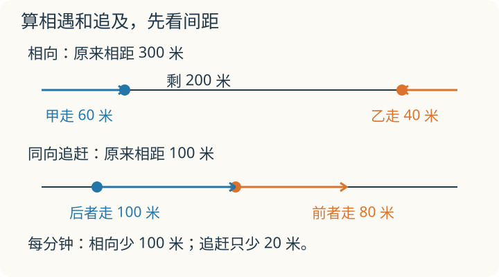

# 第 11 课：行程

两个人朝对方走，每分钟分别走 60 米和 40 米。一分钟后，中间那段空着的路少了多少米？从这段路的变化来算相遇时间。

## 每分钟靠近多少米

速度是“每单位时间走多远”。一个人 60 米/分，走 3 分钟，走 60×3=180 米。

相遇：两个人从两地相向而行，1 分钟里，甲走 60 米，乙走 40 米，两人一共靠近 100 米。所以靠近的速度是 60+40=100 米/分。总路程除以速度和，就是相遇时间。

追及：一个人在另一个人后面，同向走。1 分钟里，快的人走 100 米，慢的人走 80 米，两人之间的距离只缩短 20 米。所以追上的速度是 100−80=20 米/分。初始距离除以速度差，就是追上所需时间。

平均速度不是速度的平均。平均速度=总路程÷总时间。上山 2 千米/时、下山 6 千米/时，如果路程相同，平均速度不是 (2+6)÷2=4，而是总路程除以总时间。

## 例子

### 例 1：相遇

A、B 两地相距 300 千米，两车同时从两地相向开出，速度分别是 60 千米/时和 40 千米/时。

速度和：60+40=100 千米/时。

相遇时间：300÷100=3 小时。

相遇时，从 A 出发的车走了 60×3=180 千米；从 B 出发的车走了 40×3=120 千米。180+120=300，正好走完全程。

### 例 2：追及

弟弟先走 5 分钟，速度 60 米/分，领先 60×5=300 米。

哥哥从同地出发，速度 90 米/分。

速度差：90−60=30 米/分。

追上时间：300÷30=10 分钟。

10 分钟里，哥哥走 90×10=900 米；弟弟一共走 15 分钟，60×15=900 米，正好追上。

### 例 3：平均速度

一条山路单程 6 千米。上山速度 2 千米/时，下山速度 6 千米/时。

上山时间：6÷2=3 小时。

下山时间：6÷6=1 小时。

往返总路程：6×2=12 千米；总时间：3+1=4 小时。

平均速度：12÷4=3 千米/时。

不是 (2+6)÷2=4 千米/时。上山花的时间多，慢速度占的份量大，平均速度会被拉低。

## 易错

- 相遇用速度差，追及用速度和，正好弄反。
- 时间单位不统一。速度是千米/时，时间却用分钟，先换算。
- 平均速度算成两个速度的平均。要总路程÷总时间。
- 相遇时间=总路程÷速度和，不是除以其中一个人的速度。
- 两人出发时间不同，要先算先走的人已经走了多远，把这段距离补进初始距离。
- “相向”“同向”“相背”看清。相背而行，距离增加的速度也是速度和。

## 同向走，就一定追得上吗

甲在前面，每分钟走 80 米；乙在后面，每分钟走 60 米。两人都不停步，也不掉头，乙能追上甲吗？

看解释

不能。每分钟甲比乙多走 20 米，间距越来越大。追及题用速度差时，还要检查追的人是否更快、是否在后面。

## 练习

1. 两地相距 240 千米，两车同时相向，速度 50 和 70 千米/时，几小时相遇？
2. 甲在乙前面 200 米，甲 60 米/分，乙 80 米/分，乙几分钟追上甲？
3. 两地相距 180 千米，两车相向，3 小时相遇，一车 40 千米/时，另一车多少？
4. 上山 3 千米/时，下山 6 千米/时，单程 12 千米，往返平均速度是多少？
5. 小明 5 分钟走 300 米，速度是多少？
6. 两人在同一直路上同向走，速度保持 100 和 80 米/分，快者开始在慢者后面 60 米，几分钟追上？

## 答案

1. 240÷(50+70)=240÷120=2 小时。
2. 200÷(80−60)=200÷20=10 分钟。
3. 速度和 180÷3=60 千米/时，另一车 60−40=20 千米/时。
4. 上山 12÷3=4 小时，下山 12÷6=2 小时；总路程 24 千米，总时间 6 小时，平均速度 24÷6=4 千米/时。
5. 300÷5=60 米/分。
6. 60÷(100−80)=60÷20=3 分钟。
