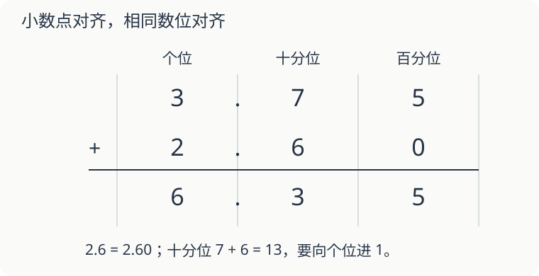

# 第 13 课：小数加减，对齐的是哪一位

一支笔 3.75 元，一块橡皮 2.6 元，一共多少元？把两个数的最后一位对齐，结果就对了吗？

## 小数点对齐，相同单位才排在一起

2.6 元就是 2.60 元。个位对个位，十分位对十分位，百分位对百分位。

百分位 `5+0=5`；十分位 `7+6=13`，写 3，向个位进 1；个位 `3+2+1=6`。所以 `3.75+2.6=6.35（元）`。

如果把 6 对到 5 的下边，就把 6 个十分之一看成 6 个百分之一，单位变了。

## 整数也可以补上小数部分

付 10 元，花 6.35 元，应找回多少？把 10 写成 10.00，再按相同数位相减。

`10.00−6.35=3.65（元）`。

退位时，1 个一可换成 10 个十分之一，1 个十分之一可换成 10 个百分之一。小数点不移动。检查：`6.35+3.65=10`。

## 先凑整，有时更好算

`1.25+3.6+0.75` 可以先算 `1.25+0.75=2`，再加 3.6，得 5.6。加法交换律、结合律在小数中也成立。

但 `10−3.6−1.4` 不能随意改成 `10−(3.6−1.4)`。前者是两次都拿走，应该合并为 `10−(3.6+1.4)=5`。

## 自己试一试

1. `4.8+2.37`。
2. `12−7.86`。
3. `3.25+1.7+0.75`，怎样算方便？
4. 小红原有 20 元，买书花 8.75 元，买笔花 3.6 元，还剩多少？
5. 小明把 `6.4−2.08` 写成 `6.40−2.08`，改变了题目吗？
6. 甲绳长 2.35 米，乙绳比甲长 0.8 米，两条合起来长多少米？

## 答案与说明

1. 7.17。
2. 4.14，可用 `7.86+4.14=12` 检查。
3. 先把 3.25 与 0.75 合成 4，再加 1.7，得 5.7。
4. `20−8.75−3.6=7.65（元）`。
5. 没有，6.4 与 6.40 相等；相减得 4.32。
6. 乙绳 `2.35+0.8=3.15` 米，两条 `2.35+3.15=5.5` 米。0.8 是两绳的差，不是乙绳的长度。
