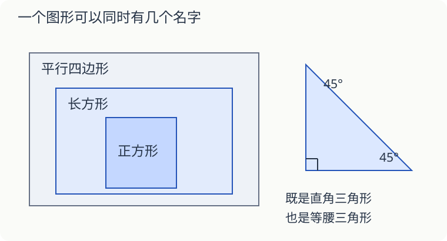

# 第 14 课：一个图形可以有两个名字吗

一个三角形既是等腰三角形，又是直角三角形，这两句话会打架吗？一条在看边，另一条在看角。

## 分类前，先说按什么分

按角分：三个角都小于 90°，是锐角三角形；有一个直角，是直角三角形；有一个钝角，是钝角三角形。

按边分：有两条边相等，是等腰三角形；三条边都相等，是等边三角形。等边三角形也满足“有两条边相等”，所以是特殊的等腰三角形。

配图的三角形有两个 45° 的角，另外一个是 90°；两条直角边相等。它可以同时叫等腰三角形和直角三角形。

## 正方形也是长方形

有两组对边分别平行的四边形，是平行四边形。长方形的两组对边也分别平行，所以长方形是一种特殊的平行四边形。

长方形有四个直角。正方形也有四个直角，还多了“四条边一样长”的特点，所以正方形又是一种特殊的长方形。

“正方形都是长方形”成立，反过来却不一定成立。长 6 厘米、宽 4 厘米的长方形，就不是正方形。

## 梯形要看清“只有一组”

本课采用小学常见的说法：只有一组对边平行的四边形叫梯形。按这个定义，平行四边形不属于梯形，因为它有两组对边平行。

判断时要找平行关系，不能因为图形斜着放就把长方形认成梯形。

## 自己试一试

1. 三角形的角是 35°、55°、90°，按角分是什么三角形？
2. 三个角都是 60°，按角分是哪类？按边分是哪类？
3. 判断：等腰三角形一定是锐角三角形。
4. 判断：所有长方形都是平行四边形。
5. 判断：四条边相等的四边形一定是正方形。
6. 按本课定义，平行四边形是梯形吗？为什么？

## 答案与说明

1. 直角三角形。
2. 锐角三角形；等边三角形，也属于等腰三角形。
3. 错。本课配图的等腰三角形就有一个直角。
4. 对，长方形的两组对边分别平行。
5. 错，还需要四个角都是直角。斜着的菱形可以四边相等，却没有直角。
6. 不是。梯形只有一组对边平行，平行四边形有两组。
