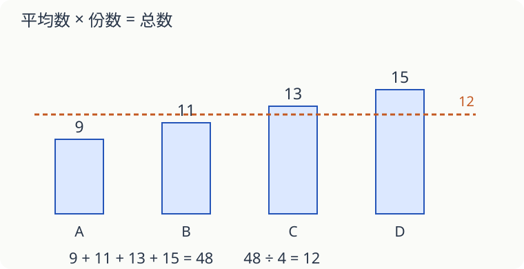

# 第 15 课：知道平均数，能找回总数吗

四个同学平均每人有 12 张卡片，他们一共有多少张？平均数像是把卡片重新分过，让每人一样多，总数没有变。

## 平均数乘人数，找回总数

`12×4=48（张）`。

这不表示每个人原来都有 12 张。例如 9、11、13、15 张，合起来也是 48 张，平均仍是 12 张。

## 少一个人的数，可以用总数减

四次跳绳平均 45 下，前三次分别是 42、46、44 下。四次总数 `45×4=180` 下，前三次共 132 下，第四次 `180−132=48` 下。

不要用 `45−42−46−44`。45 是一次的平均数，不是四次合起来的总数。

## 两组的平均数不能总是直接再平均

甲组两人平均 10 张，乙组三人平均 20 张。两组合起来：

`(10×2+20×3)÷(2+3)=80÷5=16（张）`。

若算 `(10+20)÷2=15`，就把人数不同的两组当成一样大了。两组人数相同时，可以直接把两个平均数再平均。两组人数不同时，要用总数除以总人数，不能把两组当成一样大；若两个平均数恰好相等，直接平均也会碰巧得到正确值。

## 自己试一试

1. 五个数的平均数是 18，这五个数的和是多少？
2. 三次投篮得分平均 8 分，前两次分别得 7 分、9 分，第三次多少分？
3. 四人平均身高 140 厘米，加入一位 150 厘米的同学，新平均身高多少厘米？
4. 甲组三人平均 12 分，乙组两人平均 17 分，五人平均多少分？
5. 四人平均每人 10 张卡片，小红给小明 2 张，四人的平均数变吗？
6. 六个数平均 15，其中一定有一个数等于 15 吗？

## 答案与说明

1. `18×5=90`。
2. `8×3−7−9=8（分）`。
3. `(140×4+150)÷5=142（厘米）`。
4. `(12×3+17×2)÷5=70÷5=14（分）`。
5. 不变，总张数和人数都不变。
6. 不一定。例如三个 14、三个 16，平均是 15，却没有一个数是 15。
